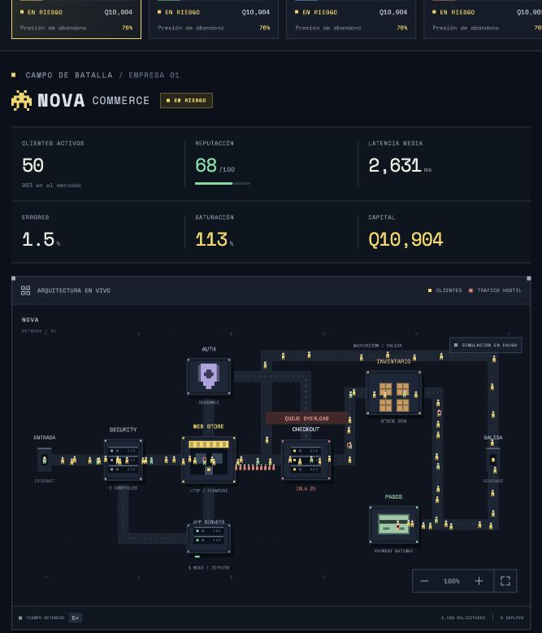

# FLOW WAR — simulador arcade de calidad de software

Especificación para una práctica universitaria competitiva de calidad de software: cinco empresas de comercio electrónico, roles separados y consecuencias visibles en una arquitectura de estilo arcade 8-bit.

**El proyecto es ejecutable.** Incluye la arena, interfaces privadas, editores conectables y pipeline multirrol. La [Entrega 2](docs/08-entrega-2-trafico-colas.md) integra tráfico individual, FIFO, capacidad, abandono y contabilidad real, conservando el escenario de concurrencia de Entrega 1. La [Entrega 3](docs/09-entrega-3-clientes-migracion.md) añade 5,000 clientes persistentes, migración competitiva, fidelidad visual y cascadas por redistribución real de demanda. Los documentos de diseño describen también ampliaciones pendientes.

```sh
npm install --include=optional --prefer-online
npm run dev
```

Abrir [http://localhost:4173](http://localhost:4173). Las credenciales locales se generan en `.local/access.json`; la de `Docente` abre la consola para iniciar la partida. Para verificar: `npm test` y `npm run build`.



## Documentos

| Documento | Contenido |
| --- | --- |
| [Arquitectura y contratos](docs/01-arquitectura.md) | Arquitectura general, componentes, modelo de datos, matriz de permisos, pipeline, sincronización y estructura de carpetas. |
| [Pantallas y componentes](docs/02-pantallas.md) | Pantalla proyectada, cinco interfaces privadas, Producto opcional, controles y dirección visual. |
| [Motor de simulación](docs/03-motor.md) | Tráfico, semántica de bloques, incidentes, migración, economía, métricas y final de partida. |
| [Etapas y criterios de aceptación](docs/04-implementacion.md) | Orden de construcción, alcance del primer prototipo, verificaciones y límites. |
| [Ejecutar el prototipo](docs/05-prototipo.md) | Inicio, acceso por rol, funciones implementadas, limitaciones y verificación. |
| [Auditoría de fidelidad](docs/06-auditoria-fidelidad.md) | Hallazgos verificados y orden de mejora progresiva del motor. |
| [Entrega 1: concurrencia](docs/07-entrega-1-concurrencia.md) | Escenario de solicitudes individuales, persistencia, límites y verificación manual por roles. |
| [Entrega 2: tráfico y colas](docs/08-entrega-2-trafico-colas.md) | Motor ordinario individual, capacidad, FIFO, deadlines, QA, recuperación, ensayos y verificación manual. |
| [Entrega 3: clientes y migración](docs/09-entrega-3-clientes-migracion.md) | Población individual, fidelización, esquema 4, eliminación y ensayos de cascada de 20/25 minutos. |

## Decisiones centrales

- Sesión de 25 minutos por defecto, configurable a 20 minutos antes de comenzar.
- Cinco empresas con 20% de mercado, recursos idénticos y un cliente visible inicial por empresa.
- React + TypeScript + Vite; Zustand para estado de interfaz; React Flow para los editores; Canvas 2D para el tráfico.
- Node.js + Express + Socket.IO; un servidor autoritativo calcula el juego y verifica cada acción.
- Flujo obligatorio: **Backend / Seguridad → QA → CTO → DevOps → producción**. Producto seguirá el mismo flujo cuando se habilite.
- Un bloque solo afecta las solicitudes que pasan por él. Sus conexiones y configuración tienen efectos funcionales.
- Los 5,000 clientes se conservan entre propietarios y el pool sin servicio; visitas reales determinan fidelidad y color persistente.
- La interfaz muestra datos, eventos, resultados de pruebas y consecuencias. No incluye ayudas, recomendaciones ni evaluación del plan.

## Cobertura de la solicitud

| Entregable solicitado | Ubicación |
| --- | --- |
| 1. Arquitectura general | Documento 01, sección 1 |
| 2. Modelo de datos | Documento 01, sección 3 |
| 3. Diagrama de componentes | Documento 01, sección 2 |
| 4. Lista de pantallas | Documento 02 |
| 5. Matriz de permisos | Documento 01, sección 4 |
| 6. Estados del pipeline | Documento 01, sección 5 |
| 7. Diseño del motor | Documento 03 |
| 8. Implementación por etapas | Documento 04 |
| 9. Estructura de carpetas | Documento 01, sección 8 |

Los diagramas usan Mermaid. Las fórmulas y valores de balance pertenecen a la documentación para desarrollo; no se presentan como instrucciones a los jugadores.

## Entrega 4A

Acciones estructuradas, artefactos con defectos persistentes, QA reproducible, operaciones DevOps, campañas y disciplina: [implementación y verificación](docs/10-entrega-4a-acciones-defectos.md). La frontera de Haiku, todavía sin llamadas API, está en [contrato de agentes](docs/11-contrato-agentes-ia.md).

Ejecutar `npm test`, `npm run build`, `npm run bench:traffic` y `npm run bench:actions`.

Verificación final: **181 pruebas**, 18 ensayos completos de acciones y 24 regresiones de tráfico/mercado. [Datos, comparación de rendimiento y conexiones](docs/benchmarks/entrega-4a-informe.md).

## Entrega 5

Crisis por reputación con sirena e iluminación accesible, documentos acumulados según tiempo simulado, FlowSlack privado, mantenimiento total y suspensión transaccional exclusiva de DevOps. El DVR reconstruye estados reales de partidas finalizadas mediante checkpoints comprimidos e inputs ordenados; conserva generaciones anteriores sin inventar intervalos antiguos.

- [Arquitectura, contratos, permisos y prueba manual](docs/12-entrega-5-crisis-flowslack-mantenimiento.md)
- [DVR, causalidad, privacidad y reconstrucción exacta](docs/13-dvr-forense.md)
- [Pruebas, benchmarks y limitaciones medidas](docs/benchmarks/entrega-5-informe.md)

```sh
npm test
npm run build
npm run bench:traffic
npm run bench:actions
npm run bench:connections
npm run bench:chat
npm run bench:entrega5
```

El dominio actual mantiene compras, inventario y pagos; la adaptación a plataformas de inversión queda pendiente. Esta entrega funciona localmente sin Anthropic, claves ni consumo de API.

### Hardening final de Entrega 5

[Informe, resultados de 27 conexiones y límites de rendimiento](docs/15-hardening-final-entrega-5.md). [Evidencia y verificación independiente](docs/benchmarks/final-hardening/README.md).

`npm run bench:classroom -- --duration=1200 --speed=20 --label=mi-auditoria` ejecuta un servidor real con 25 sesiones estudiantiles, docente y proyector, cada vez sobre una base temporal. Use `--speed=1` para medir la duración real de una partida de veinte minutos. Las excepciones de latencia del ensayo publicado se conservan en el informe; no se declaran cumplidos todos los presupuestos.

## Entrega 6

Backend entrega su funcionalidad a Seguridad, que escribe protecciones libres sobre los mismos bloques.
QA, CTO y DevOps trabajan con la combinación exacta de versiones. Ambos departamentos pueden preparar
borradores revisables con Claude. La integración real requiere `ANTHROPIC_API_KEY` y `ANTHROPIC_MODEL`
en el servidor; no hay sustitución simulada en producción.

- [Arquitectura, configuración, migración y límites](docs/17-backend-seguridad-colaborativos-ia.md)
- [Pruebas y mediciones de 27/32 conexiones](docs/benchmarks/entrega-6/README.md)

```sh
npm test
npm run build
npm run bench:collaboration -- --students=25 --duration=1200 --dvr=off --label=mi-aula-27
npm run bench:collaboration -- --students=30 --duration=1200 --dvr=off --label=mi-aula-32
```


La Entrega 7 incorpora laboratorio QA conversacional, cartas de devolución con evidencia,
bloqueo Backend aplicado por el servidor, decisiones y órdenes de inversión del CTO,
y conversaciones Claude aisladas por empresa y rol. Configuración y límites en
[docs/18-qa-cto-asistentes-por-empresa.md](docs/18-qa-cto-asistentes-por-empresa.md);
resultados reproducibles en [docs/benchmarks/entrega-7/README.md](docs/benchmarks/entrega-7/README.md).
La conexión real se comprueba con `npm run verify:anthropic` después de configurar `.env`.

Rendimiento E7 (fases 1 y 2): los comandos que llegan en la misma vuelta del bucle se confirman
en una sola transacción SQLite (group commit; `FLOW_GROUP_COMMIT=0` vuelve a la ruta por comando y
`FLOW_GROUP_COMMIT_MAX` acota el lote, 64 por defecto) y `state:update` se codifica sin el escaneo
binario de socket.io, con bytes idénticos. Diseño, garantías y riesgos en
[docs/19-group-commit-y-codificador.md](docs/19-group-commit-y-codificador.md); benchmark pareado en
[docs/benchmarks/entrega-7-group-commit/README.md](docs/benchmarks/entrega-7-group-commit/README.md).
