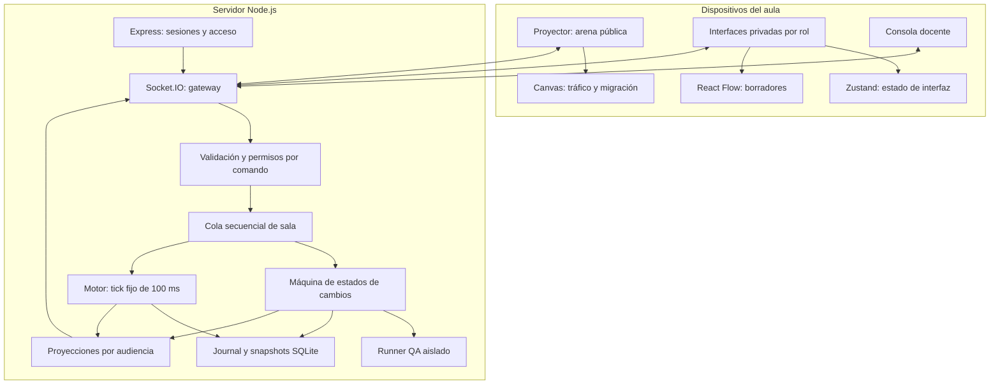
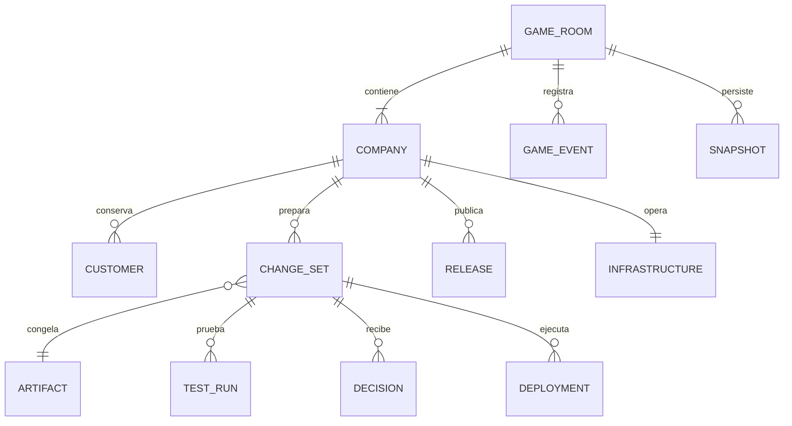
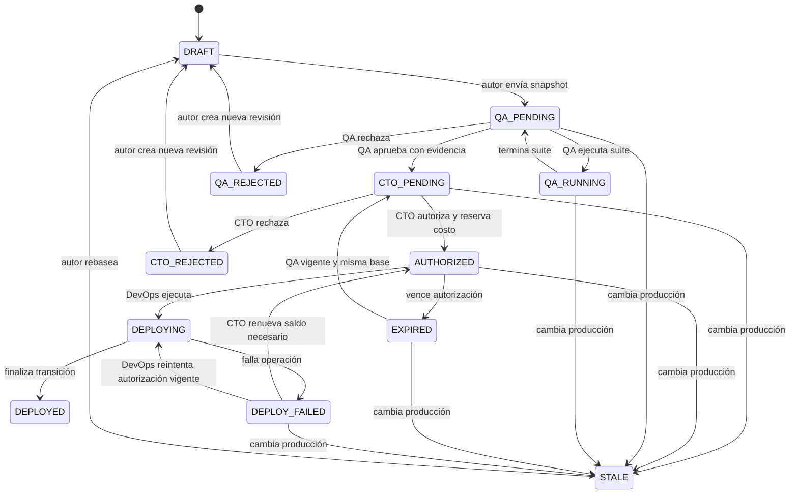

# FLOW WAR — arquitectura y contratos

Estado: diseño previo al código. Alcance: una sala de cinco empresas en un servidor local, con 25 participantes obligatorios, una pantalla proyectada y un operador docente. Producto puede agregar cinco participantes.

## 1. Arquitectura general

Se implementará un monolito modular en TypeScript con dos aplicaciones y paquetes compartidos. Un proceso de servidor ejecutará el motor, los comandos, las pruebas simuladas y las proyecciones de datos. Todos los dispositivos de la clase se conectarán a ese proceso por la red local.

| Capa | Tecnología | Responsabilidad |
| --- | --- | --- |
| Interfaz | React + TypeScript + Vite | Rutas, interfaces por rol y presentación. |
| Estado de interfaz | Zustand | Empresa enfocada, selección del editor, borradores locales y copia de la proyección autorizada. |
| Editor de piezas | React Flow, paquete `@xyflow/react` | Arrastrar nodos, configurar puertos y conectar piezas. |
| Tráfico | Canvas 2D | Dibujar arquitectura, solicitudes, colas y migraciones con interpolación. |
| HTTP | Node.js + Express | Sesiones, creación de sala, recuperación y salud del servidor. |
| Tiempo real | Socket.IO | Comandos confirmados, eventos y snapshots por audiencia. |
| Dominio | TypeScript independiente de React | Motor determinista, permisos, pipeline, costos y pruebas. |
| Persistencia local | SQLite | Eventos ordenados y snapshots para recuperar una sesión. |

Canvas 2D es suficiente como decisión inicial para el límite de sprites propuesto. PixiJS quedará sujeto a una medición que justifique sustituirlo. No se simularán visitas abriendo conexiones HTTP reales.

El servidor es la única autoridad para capital, mercado, reloj, incidentes, revisiones y despliegues. Zustand no calcula resultados oficiales. Los comandos se procesan en una cola secuencial por sala, evitando carreras entre CTO, QA, DevOps y los ticks.

## 2. Diagrama de componentes



El runner de QA usa el mismo intérprete de solicitudes en un estado aislado. Sus compras, errores y ataques no alteran producción. Los temporizadores de QA y despliegue avanzan mediante ticks de simulación.

## 3. Modelo de datos

Identificadores opacos; dinero en centavos enteros de quetzal; tiempo de simulación en milisegundos enteros; enums compartidos y payloads validados en servidor. El estado serializable excluye conexiones de red y objetos propios de React Flow.

| Entidad | Campos principales | Relaciones y reglas |
| --- | --- | --- |
| `GameRoom` | `id`, `status`, `seed`, `rngState`, `tick`, `durationMs`, `scenarioVersion`, `engineVersion`, `eventSeq` | Exactamente cinco empresas; estados `LOBBY`, `RUNNING`, `PAUSED`, `FINISHED`. |
| `Membership` | `id`, `roomId`, `companyId?`, `role`, `credentialHash`, `revokedAt?` | Una credencial identifica una empresa y un rol; proyector y docente no son roles de empresa. |
| `Session` | `id`, `membershipId`, `expiresAt`, `revokedAt?` | Sesión opaca en cookie HttpOnly; no usar el ID efímero del socket como identidad. |
| `Company` | `id`, `name`, `color`, `status`, `capitalCents`, `reservedCents`, `reputation`, `abandonmentPressure`, `collapseSinceTick?` | Posee clientes, versiones, infraestructura y métricas. |
| `Customer` | `id`, `companyId`, `loyaltyMix[5]`, `successfulVisitsSinceMigration`, `lastMigrationTick`, `requestOrdinal` | 5,000 clientes persistentes; un único propietario por cliente. |
| `Request` | `id`, `customerId?`, `companyId`, `kind`, `arrivalTick`, `stage`, `eligibleTick`, `deadlineTick`, `executionContext` | `kind`: compra, navegación, reintento o ataque. Contexto guarda principal, SKU, versión de lectura, clave idempotente y nodos recorridos. |
| `GraphDraft` | `id`, `companyId`, `domain`, `revision`, `baseDomainVersion`, `nodes[]`, `edges[]` | Un borrador por dominio; edición con revisión esperada. |
| `GraphNode` | `id`, `blockType`, `position`, `parameters` | Sin código arbitrario; parámetros limitados por catálogo del servidor. |
| `GraphEdge` | `id`, `source`, `sourcePort`, `target`, `targetPort` | Referencias existentes, puertos compatibles, sin ciclos. |
| `Artifact` | `id`, `domain`, `graph`, `hash`, `compilerVersion` | Snapshot inmutable de nodos, conexiones y parámetros. |
| `ChangeSet` | `id`, `companyId`, `authorId`, `domain`, `revision`, `baseReleaseId`, `artifactId`, `status`, `costQuoteId`, `priority` | Los resultados y aprobaciones quedan ligados al hash exacto del artefacto y a su base. |
| `CostQuote` | `id`, `artifactHash`, `deploymentMaxCents`, `runtimeBudgetCents`, `runtimeDurationTicks`, `allowedStrategies`, `catalogVersion` | Desglosa publicación y operación; CTO autoriza este objeto exacto. Cambiar el monto o alcance invalida su autorización. |
| `TestRun` | `id`, `changeId`, `artifactHash`, `baseReleaseId`, `suite`, `seed`, `status`, `observations`, `startedTick`, `finishedTick?` | Estado `QUEUED`, `RUNNING`, `COMPLETED` o `CANCELED`; observaciones y aserciones, sin recomendación. |
| `Decision` | `id`, `changeId`, `actorId`, `kind`, `reason?`, `tick` | Aprobación o rechazo explícito de QA y CTO; append-only. |
| `CostReservation` | `id`, `companyId`, `changeId?`, `amountCents`, `expiresTick`, `state` | Reserva de despliegue o presupuesto operativo; evita comprometer el mismo capital dos veces. |
| `Deployment` | `id`, `changeId`, `artifactHash`, `expectedReleaseId`, `strategy`, `status`, `startedTick`, `finishedTick?`, `chargedCents` | Una ejecución activa por empresa. |
| `Release` | `id`, `companyId`, `backendArtifactId`, `securityArtifactId`, `productConfigId?`, `previousReleaseId?` | Una versión compuesta publicada; un cambio de dominio conserva los otros dominios. |
| `Infrastructure` | `companyId`, `revision`, `servers[]`, `loadBalancer`, `scalingPolicy?`, `budgetEnvelopeId?` | Capacidad, salud y costos; cada servidor tiene estado y tiempo de disponibilidad. |
| `InventoryItem` | `companyId`, `sku`, `stock`, `version`, `lockOwner?`, `lockUntilTick?` | Estado operativo donde se modelan carreras y bloqueos. |
| `IdempotencyRecord` | `companyId`, `key`, `status`, `response`, `expiresTick` | Resultado de una operación; clave compartida por reintentos de esa compra. |
| `Incident` | `id`, `companyId`, `type`, `startedTick`, `status`, `observedCounts`, `quietSinceTick?` | Causa interna separada de síntomas visibles. |
| `MetricsWindow` | `companyId`, `fromTick`, `toTick`, `counts`, `latencyBuckets`, `queueDepth`, `utilization` | Ventana móvil de 10 s y acumulados por partida. |
| `GameEvent` | `id`, `roomId`, `seq`, `tick`, `type`, `payload`, `audience` | Secuencia total de sala; el público solo recibe eventos sanitizados y su propio cursor de stream. |
| `Snapshot` | `roomId`, `eventSeq`, `tick`, `schemaVersion`, `state`, `checksum` | Incluye PRNG, fracciones de acumuladores, trabajos y colas para replay. |

Relaciones principales:



Los grafos de edición y el grafo de arquitectura pública son modelos distintos. La arquitectura pública muestra los servicios desplegados, sin publicar borradores ni decisiones privadas.

## 4. Matriz de permisos

`✓`: acción exclusiva autorizada. `—`: comando rechazado por el servidor. Todos los roles pueden leer la arena pública y sus propios datos operativos definidos en el documento de pantallas.

| Acción | CTO | Backend | Seguridad | QA | DevOps | Producto opcional |
| --- | :---: | :---: | :---: | :---: | :---: | :---: |
| Editar grafo de lógica | — | ✓ | — | — | — | — |
| Editar grafo de seguridad | — | — | ✓ | — | — | — |
| Proponer feature o promoción | — | — | — | — | — | ✓ |
| Enviar su propio cambio a QA | — | ✓ | ✓ | — | — | ✓ |
| Ejecutar suites | — | — | — | ✓ | — | — |
| Aprobar o rechazar QA | — | — | — | ✓ | — | — |
| Autorizar costo y riesgo | ✓ | — | — | — | — | — |
| Priorizar incidentes | ✓ | — | — | — | — | — |
| Autorizar presupuesto operativo | ✓ | — | — | — | — | — |
| Solicitar presupuesto de infraestructura | — | — | — | — | ✓ | — |
| Escalar dentro de presupuesto autorizado | — | — | — | — | ✓ | — |
| Configurar balanceador dentro del alcance autorizado | — | — | — | — | ✓ | — |
| Elegir estrategia y desplegar cambio autorizado | — | — | — | — | ✓ | — |
| Reejecutar despliegue fallido con autorización vigente | — | — | — | — | ✓ | — |
| Ejecutar rollback autorizado | — | — | — | — | ✓ | — |

Reglas de acceso:

1. El docente genera credenciales aleatorias independientes por empresa/rol. Elegir una URL no otorga ese rol.
2. El servidor deriva empresa y rol de la sesión. No acepta identidades enviadas dentro del comando.
3. El handshake autentica la sesión; cada comando vuelve a comprobar permiso, pertenencia, estado de sala y revisión del recurso.
4. Las salas de Socket.IO se asignan desde el servidor: arena pública, empresa/rol y operador. No habrá un comando libre para unirse a salas.
5. Cada audiencia recibe un DTO específico; no se envía el estado completo para ocultarlo después con CSS.
6. El proyector no puede mutar el juego. El docente puede crear, iniciar, pausar, finalizar y restablecer una sala, sin operar roles de empresa desde su consola.
7. Una sesión reconectada conserva rol y empresa. Reasignar un rol exige revocar su credencial anterior desde la consola docente.
8. Un rol desconectado no se sustituye automáticamente. El docente puede pausar o reasignar; no se saltan etapas.

Un costo de infraestructura requiere una autorización del CTO con monto, duración, tipos de operación y máximo de servidores. DevOps elige y ejecuta dentro de ese alcance. Reducir servidores no devuelve dinero ya consumido. Las autorizaciones iniciales son idénticas para las cinco empresas y cubren solamente su infraestructura mínima.

## 5. Estados del pipeline de cambios



| Estado o transición | Condición y efecto |
| --- | --- |
| `DRAFT` | Editable solo por su autor de dominio. Guardar un borrador no cambia producción. |
| Envío a QA | Valida formato ejecutable, congela artefacto, calcula costo reproducible y registra versión base. |
| `QA_RUNNING` | Una suite dura 3–6 s simulados; una corrida activa por cambio en el MVP. Se pueden ejecutar otras suites después. El autor no puede alterar el artefacto enviado. |
| QA aprueba | Exige al menos una suite terminada, ninguna en ejecución y una decisión humana. Se permite aceptar resultados con fallos; se registra aceptación de riesgo sin recomendarla. |
| QA rechaza | Registra observaciones opcionales; una corrección crea nueva revisión y descarta aprobaciones anteriores. |
| CTO autoriza | Acepta los montos desglosados de publicación y operación, y reserva saldo disponible. Puede incluir autorización de rollback a la base probada con un monto independiente. |
| `AUTHORIZED` | Válida para iniciar durante 60 s simulados. El máximo de publicación incluye el gasto temporal de las estrategias permitidas; opciones fuera del alcance requieren nueva autorización. Una ejecución iniciada a tiempo no se cancela por ese vencimiento. |
| `DEPLOYING` | Se bloquea la ejecución paralela para esa empresa y se fija la base. Las solicitudes siguen la política de transición de DevOps. |
| `DEPLOYED` | Se publica el nuevo `Release`, se cobra la publicación ejecutada, se libera su sobrante y se mantiene la reserva operativa aprobada hasta consumirla o vencerla. |
| `DEPLOY_FAILED` | Producción conserva la base o queda parcialmente degradada según la estrategia. Se registra gasto real y reserva restante; reintentar no duplica cargos ya efectuados. |
| `STALE` | Otra publicación cambió la base. Se cancelan pruebas pendientes y se liberan reservas; rebase y QA son obligatorios. |
| Rollback | DevOps restaura solo una versión expresamente autorizada por CTO. Es un nuevo evento de despliegue; no revierte dinero, reputación ni clientes perdidos. Sin autorización previa necesita nueva decisión del CTO. |

El rollback permitido apunta a la base de un cambio probado por QA y autorizada junto con ese cambio. No permite publicar un artefacto nuevo ni omitir QA para una solución nueva.

Backend y Seguridad pueden trabajar simultáneamente. Sus cambios conservan ambos dominios, pero el MVP invalida conservadoramente la evidencia si cambia la versión compuesta base, incluso si se modificó otro dominio. No hay merges automáticos después de QA.

La corrección funcional de un artefacto no se comprueba al desplegar para impedir una mala decisión. Un despliegue puede completarse técnicamente y producir errores. Los fallos de despliegue provienen del proceso operativo: capacidad temporal, servidores disponibles y tiempos de transición.

Presupuesto temporal del recorrido humano: preparación libre, QA 3–6 s, autorización humana y deploy de 3–8 s. Objetivo de interacción: completar un recorrido coordinado en 20–40 s; no es una garantía de duración de decisiones humanas.

## 6. Contrato de comandos y sincronización

Todo comando contiene `commandId`, `roomId`, `type`, `targetId`, `expectedRevision` cuando corresponde y `payload`. `roomId` debe coincidir con la sesión; no concede acceso. La respuesta devuelve `commandId`, `accepted`, `code`, `resourceRevision` y el cursor de su stream autorizado.

| Comando | Emisor | Resultado autorizado |
| --- | --- | --- |
| `draft.save`, `change.submit` | Backend, Seguridad; Producto si está habilitado | Guarda su dominio o crea cambio inmutable. |
| `qa.run`, `qa.approve`, `qa.reject` | QA | Registra resultados o mueve el cambio. |
| `cto.authorize`, `cto.reject`, `cto.prioritize`, `cto.approveBudget` | CTO | Reserva costos, registra decisión o prioridad. |
| `infra.requestBudget`, `infra.scale`, `infra.configureBalancer` | DevOps | Solicita alcance o aplica operación autorizada. |
| `deploy.start`, `deploy.retry`, `deploy.rollback` | DevOps | Ejecuta el artefacto y autorización indicados. |
| `arena.focus` | Proyector | Solo cambia la empresa enfocada en esa sesión de proyector. |
| `room.start`, `room.pause`, `room.resume`, `room.finish`, `room.reset`, `access.rotate` | Docente | Control del ciclo de sala y credenciales. |

Errores factuales: `FORBIDDEN`, `VERSION_CONFLICT`, `INVALID_TRANSITION`, `INVALID_GRAPH`, `INSUFFICIENT_FUNDS`, `AUTHORIZATION_EXPIRED`, `ROOM_PAUSED`. No contienen sugerencias sobre la decisión de juego.

- Deduplicación de `commandId` por identidad y sala: reenviar el mismo ID/payload devuelve el resultado anterior sin repetir efecto. Reutilizar ID con payload distinto se rechaza.
- Deduplicación y cambios de estado se confirman en la misma transacción persistida antes del ACK. Sus registros se conservan durante toda la partida y la recuperación.
- Frecuencia de snapshots de red: 5 Hz; animación local hasta 60 Hz. Cada stream lleva secuencia propia, tick y versión de esquema.
- Los snapshots son completos para su audiencia en el MVP. Un salto de secuencia solicita otro snapshot; no hace falta reconstruir todas las animaciones omitidas.
- Reconectar solicita estado y decisiones actuales antes de habilitar comandos. Los comandos no confirmados se reintentan con el mismo ID; nuevos comandos permanecen deshabilitados hasta sincronizar.
- Cada cambio y reporte tiene sus propios números de revisión. Un tick nuevo no produce conflictos artificiales en una edición de borrador.
- Identificadores de empresa y rol en rutas son navegación; el control de acceso sigue siendo del servidor.

## 7. Persistencia y operación

Un único proceso escribe por sala. El journal persiste ticks de 100 ms y comandos aceptados con orden total. Un snapshot completo cada 5 s guarda el estado, la semilla y el estado del PRNG. Recuperar carga el último snapshot y reproduce el journal posterior con la misma versión de motor. El ACK se emite después de persistir el comando; no promete continuidad durante una caída del host.

El proceso recuperado comienza en `PAUSED`; el tiempo caído no consume partida ni produce visitas, costos o vencimientos. El docente reanuda explícitamente. Un journal corrupto o una versión incompatible impide iniciar esa sala y conserva los archivos para diagnóstico.

En la práctica local, Express sirve el frontend compilado y comparte origen con Socket.IO. Solo el servidor necesita acceso a SQLite. Se requieren dispositivos en la misma red y un host accesible; no se incorpora hosting externo a esta entrega. Las credenciales no aparecen en URLs ni en proyecciones públicas. Las sesiones se validan y los intentos de acceso se limitan en el servidor; fuera de localhost se usa HTTPS para protegerlas.

La consola separa claramente `RESTABLECER SALA` del botón de inicio y pide confirmar ese borrado de partida. Esta confirmación pertenece al producto, no al trabajo de diseño.

## 8. Estructura de carpetas propuesta

```text
flow-war/
├── apps/
│   ├── web/
│   │   ├── src/
│   │   │   ├── app/                 # Rutas, sesión y shell por rol
│   │   │   ├── features/
│   │   │   │   ├── arena/           # Proyector y ranking
│   │   │   │   ├── traffic/         # Canvas, sprites e interpolación
│   │   │   │   ├── node-editor/     # Catálogo visual y conexiones
│   │   │   │   ├── backend/
│   │   │   │   ├── security/
│   │   │   │   ├── qa/
│   │   │   │   ├── cto/
│   │   │   │   ├── devops/
│   │   │   │   ├── product/
│   │   │   │   └── operator/
│   │   │   ├── stores/              # Solo proyecciones y estado de UI
│   │   │   ├── transport/           # Socket, ACK y resync
│   │   │   └── styles/              # Tokens, pixel UI y accesibilidad
│   │   └── public/fonts/            # Fuentes locales con licencia
│   └── server/
│       └── src/
│           ├── http/                # Sesión, salud y bootstrap
│           ├── realtime/            # Gateway y salas autorizadas
│           ├── auth/                # Credenciales, cookies y permisos
│           ├── rooms/               # Cola, ciclo y reloj
│           ├── commands/            # Handlers, idempotencia y revisiones
│           ├── projections/         # DTO público y DTO por rol
│           └── persistence/         # SQLite, journal y recuperación
├── packages/
│   ├── contracts/                   # Tipos, esquemas y eventos públicos
│   ├── domain/                      # Pipeline, reservas y políticas
│   ├── simulation/                  # Intérprete, colas, mercado y PRNG
│   ├── scenarios/                   # Parámetros versionados; solo servidor
│   └── ui/                          # Piezas visuales compartidas
├── tests/
│   ├── domain/
│   ├── simulation/
│   ├── integration/
│   └── e2e/
├── docs/
└── data/                            # SQLite local, excluido de Git
```

No se requieren microservicios, Redis ni colaboración simultánea sobre el mismo editor para el primer prototipo. Dos pestañas del mismo rol resuelven conflictos mediante revisiones, sin sobreescribir silenciosamente.

## 9. Referencias técnicas verificadas

React Flow ofrece nodos personalizados y puertos conectables; su validación de conexión se usará para restricciones estructurales. La semántica del juego la implementa el intérprete propio. Fuentes: [nodos personalizados](https://reactflow.dev/learn/customization/custom-nodes) y [validación](https://reactflow.dev/examples/interaction/validation).

Socket.IO permite emitir a subconjuntos mediante salas asignadas en servidor. Su entrega predeterminada no garantiza recuperar mensajes perdidos, por lo que se especifican IDs, confirmaciones y snapshots de aplicación. Fuentes: [salas](https://socket.io/docs/v4/rooms/) y [garantías de entrega](https://socket.io/docs/v4/delivery-guarantees/).

El middleware de conexión autentica el handshake; la autorización de cada operación se hará dentro del despachador de comandos. Fuente: [middleware de Socket.IO](https://socket.io/docs/v4/middlewares).

Zustand será un store de interfaz con selectores; el estado autoritativo permanece en servidor. Referencia de la herramienta: [introducción oficial](https://zustand.docs.pmnd.rs/learn/getting-started/introduction).
