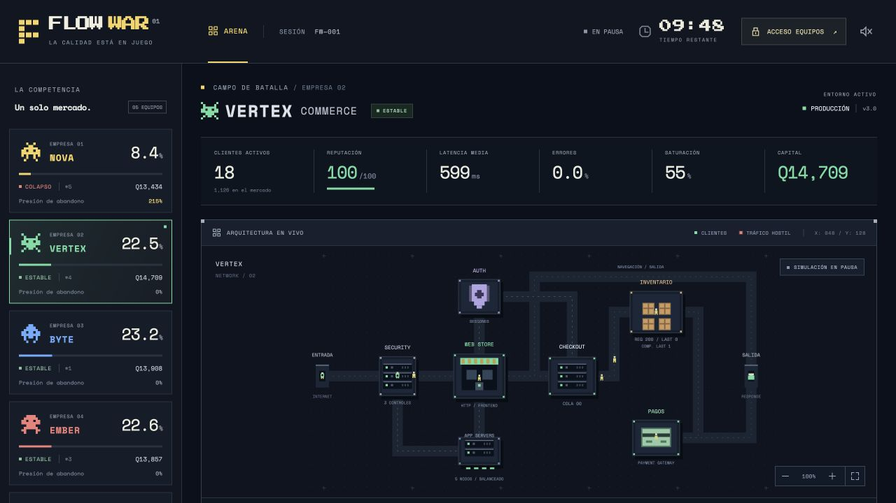

# Entrega 3 — clientes persistentes, migración y fidelización

## Base auditada y alcance

Implementación sobre `codex/entrega-2-trafico-colas-abandono`, commit exacto `deaf343`, en `codex/entrega-3-clientes-migracion-fidelizacion`. Se reprodujeron las **83 pruebas originales** y los **seis benchmarks originales**, antes de cambiar el motor. No se modificó `main` ni se hizo merge. La evidencia reproducida se conserva con los reportes de esta entrega.

La auditoría encontró que `traffic.ts` creaba visitantes por módulo del contador de solicitudes; la antigua migración movía cantidades y restringía al receptor por cupos de capacidad. Además, el Canvas mezclaba colores por progreso de animación. Se sustituyeron esos tres mecanismos conservando el intérprete de transacciones, colas FIFO, economía, roles, pipeline y geometría existentes.

Los cortes A–I quedan implementados en un solo modelo: contratos/auditoría, población, admisión, decisiones/transferencia, experiencias/color, eliminación, proyección, recuperación/pruebas y ensayos completos. No hay modelos de clientes intermedios que reconciliar.

## Estado e invariantes

`GameState.schema = 4`. `GameState.market` es exclusivo del servidor. Contiene exactamente **5,000** registros `MarketCustomer`, configuración `market-3.0`, cursores de selección, índices ordenados de pertenencia, propuestas pendientes y acumuladores. Las partidas nuevas empiezan con 1,000 por empresa, mismos recursos y lealtad 1. Los identificadores `g<generación>-U<ordinal>` no contienen información personal y sobreviven a reinicios; solo restablecer la sala inicia una población de otra generación.

Cada cliente conserva ID, origen inmutable, propietario actual o `null`, procedencia importada, experiencias por empresa, solicitudes activas, historial de transferencias, lealtad, color de inicio de transición y color efectivo. Origen, propietario, historial y fidelidad son conceptos separados. La población no se añade a `Company`, evitando que un spread en una proyección la filtre.

Invariantes comprobadas por `assertMarket` al crear/recuperar, cada segundo de simulación, al evacuar y al finalizar:

- Existen exactamente 5,000 IDs, cada uno en un único índice de propietario o en `unserved`.
- Los índices y propietarios individuales coinciden; `Company.customers` y `GameState.unserved` coinciden con sus longitudes.
- `sum(empresas.customers) + unserved = 5000`.
- Las referencias activas coinciden con solicitudes ordinarias/LAST-UNIT admitidas y todavía no contabilizadas.
- No hay duplicados en propuestas pendientes, ni propuestas de clientes desconocidos.
- Fidelidad en `[0,1]`, colores hexadecimales válidos y origen válido o explícitamente desconocido.
- Una empresa eliminada no conserva clientes una vez completada la evacuación.

Los contadores agregados son índices materializados, no una segunda autoridad modificable mediante comandos. `flushMigrations` cambia propietario, ambos índices, contadores e historial en una misma operación síncrona, sin `await`; el writer SQLite los confirma juntos con recibos y deduplicación de comandos. Toda corrupción recuperada falla de forma explícita en vez de inventar identidades o ajustar población.

## Estructuras y admisión

`market.customers[id]` permite acceso constante. `members[companyId]` son vectores persistidos; un mapa de posiciones efímero permite borrar intercambiando con el último elemento e insertar en O(1). Cada lote ordena sus eliminaciones e inserciones por cohorte y origen relativo al propietario del índice, en dos fases independientes. Ese orden cíclico cuesta O(m log m) para m transferencias listas y evita que el orden global de nacimiento de las empresas altere futuras visitas. Persistir el orden de esos vectores y los cursores evita que un reinicio cambie futuras selecciones. Los enlaces e índices efímeros usan WeakMap y se reconstruyen al recuperar, clonar para rollback, restablecer o avanzar; no se serializan ni se envían al navegador.

La selección legítima rota por propietarios reales, sin recorrer los 5,000 registros por solicitud. Se saltan clientes que ya decidieron marcharse: no reciben nuevas operaciones que perpetúen su espera. Habitualmente la selección es O(1); si muchos clientes tienen salida pendiente puede recorrer el vector de esa empresa, con límite en su tamaño. La decisión de mercado hace una pasada de 5,000 cada segundo, no cada frame ni cada admisión. Vaciar pendientes revisa solo ese conjunto.

La demanda conserva la fórmula de Entrega 2:

```
llegadas/s = (5 + 295 × (tick / duración)^1.25) × clientes_reales_empresa / 5000
```

Los restos fraccionales siguen persistidos. Cada transferencia cambia una unidad de demanda potencial; perder o captar mercado no cambia servidores, presupuesto, precios ni capacidad. Una empresa activa con cero propietarios no genera tráfico legítimo. Los ataques siguen siendo otra clase y no tienen `customerId`. QA Carga usa un namespace explícito `qa` dentro de su copia aislada; sus identidades no pertenecen a producción y nunca actualizan fidelidad de producción.

También las dos intenciones de LAST-UNIT se vinculan a clientes reales. Su stock, intérprete, orden de operaciones y resultados de concurrencia se conservan. Si no existen clientes admisibles no se inventa una cohorte. El antiguo test que ponía `company.customers = 0` para silenciar tráfico ordinario ahora usa deuda de llegadas de la fixture; mantiene todas sus comprobaciones transaccionales sin corromper el índice de propietarios.

## Solicitudes activas y atomicidad comercial

Una propuesta guarda destino, razón y tick. El propietario no cambia hasta que `activeRequests === 0`. Puede haber varias operaciones activas del mismo cliente, incluidas LAST-UNIT; todas deben terminar. Mientras tanto otros clientes siguen operando y migrando.

Cada solicitud conserva empresa, intención, ruta y versión desde su admisión. La migración no mueve colas, pagos, reservas ni inventarios. El resultado terminal se liquida bajo el guard `accounted` existente. En ese mismo guard se aplica una sola experiencia y se libera una referencia activa. La transferencia puede efectuarse en el siguiente paso del motor, después de liquidar todas las empresas.

Una reserva que termina en `PENDING_RESOLUTION` sigue registrada en el ledger original y no bloquea de por vida a su cliente. Su traslado no la reembolsa, duplica ni confirma. Cancelar por fin de sala o eliminación conserva ventas ya pagadas y resuelve las solicitudes según las reglas existentes. Esas cancelaciones administrativas no se registran como visitas satisfactorias ni como insatisfacción comercial observada.

No hay ingresos, margen, compensación ni compra asociados a transferencias o cambios de lealtad. Se conservan precio Q45, contribución Q3 por unidad legítima y compensación Q8 por sobreventa confirmada. Los ingresos potenciales perdidos siguen separados del capital.

## Experiencias y color persistente

Los parámetros están guardados en cada partida, con versión `market-3.0`:

| Evento legítimo liquidado | Cambio de lealtad | Insatisfacción |
| --- | ---: | ---: |
| Navegación OK hasta 1,000 ms o consulta OK hasta 2,000 ms, sin sobreventa | +0.08 | −2, mínimo 0 |
| Compra OK, sin sobreventa, hasta 3,000 ms | +0.12 | −2, mínimo 0 |
| Resultado OK pero lento | −0.04 | +1 |
| Navegación fallida/rechazada/abandonada | −0.08 | +2 |
| Consulta fallida/rechazada/abandonada | −0.10 | +2 |
| Compra fallida/rechazada/abandonada | −0.18 | +4 |
| Sobreventa o reserva impagada terminal | −0.28 | +8 |

Los umbrales se parametrizan por tipo: una compra recorre seguridad, web, checkout, inventario y pago, por lo que una compra normal de aproximadamente 1.6–2 s no se penaliza como si fuera una navegación lenta. La insatisfacción tiene techo 20; la fidelidad se acota a `[0,1]` y redondea a seis decimales. Un fallo no solicita una migración por sí mismo. Los resultados exitosos lentos cuentan como operaciones exitosas, pero deterioran la relación; una visita plenamente satisfactoria se define por resultado y latencia, no por la presencia de una pieza. El tiempo sin visitas no mejora ni degrada el color.

Al transferir se conserva exactamente el color efectivo como `transitionFromColor`, se reinicia lealtad hacia el nuevo propietario a 0 y se registra el historial. Se reduce a la mitad la insatisfacción acumulada, sin borrarla completamente. La siguiente transición parte de ese color, incluso en NOVA → VERTEX → BYTE.

La interpolación ocurre en el servidor, en **sRGB lineal**: decodificar la función de transferencia sRGB, interpolar los tres canales lineales con la lealtad y recodificar/redondear a RGB de 8 bits. Evita oscurecimientos artificiales de mezclar directamente canales gamma. El color final solo se recalcula tras una experiencia liquidada. Tras migrar hacen falta 13 navegaciones rápidas o 9 compras rápidas para alcanzar fidelidad 1 desde 0, siempre que no haya experiencias adversas entre ellas. Estos ejemplos son calibración técnica; no aparecen como consejos en la interfaz.

## Hazard y elección competitiva

La presión empresarial sigue el modelo observado de Entrega 2 y conserva su techo **300%**. No es una probabilidad. Para un intervalo `dt`:

```
v = 0.35 + 0.65 × (1 - lealtad)
    + insatisfacción / 10 + 0.1 × min(5, fallos_consecutivos)
λ = 0.002 × presión / 100 × v
P = -expm1(-λ × dt)
```

El contador consecutivo representa experiencias adversas, incluyendo resultados OK lentos; no sustituye el contador de errores HTTP/comerciales. Se evalúa una vez por segundo con PRNG de contador determinista. `P` siempre está entre 0 y 1. Para un cliente plenamente fiel, sin experiencia adversa, una presión constante de 100%, 140% y 200% produce respectivamente 0.0700%, 0.0980% y 0.1399% de disposición por segundo. En 20/25 minutos, la probabilidad de al menos una decisión bajo presión 100% constante es aproximadamente 56.8%/65.0%; a 200% es 81.4%/87.8%. Son referencias analíticas con estado fijo, no porcentajes forzados de clientes que efectivamente cambian de empresa. La presión, fidelidad, cooldown, elegibilidad y calidad real cambian durante la partida.

La atracción usa reputación, disponibilidad observada/operativa, errores y congestión. La congestión reduce suavemente el atractivo mediante un denominador, sin imponer un cupo de aceptación por capacidad. Se añaden preferencias estables por cliente/empresa y memoria de experiencias reales, y se penaliza retornar pronto al propietario anterior. El peso de un destino depende de su calidad relativa; una ventaja de hasta ocho centésimas en preferencia puede inclinar empates. La selección ponderada considera todos los destinos viables y una opción explícita de salida del mercado.

No se elige automáticamente el máximo de reputación. No se reserva capacidad futura ni se escala al receptor. Un destino atractivo puede captar más de lo que soporta. Destinos eliminados o por debajo de atracción 0.18 tienen peso cero; si no queda alternativa, el resultado es `null`.

El cooldown normal es **90 segundos** y se verifica tanto en decisiones como en la entrada a la transferencia. No protege permanentemente a una empresa deficiente. La eliminación real del propietario lo exceptúa. Se penaliza el retorno a la empresa anterior durante 240 segundos, sin prohibirlo.

Un cliente sin servicio sigue existiendo. Tras su cooldown evalúa reingreso con hazard 0.003/s (unos 333 segundos medios hasta un intento, más cooldown), selecciona entre empresas activas y puede continuar fuera si ninguna es viable. No retorna automáticamente al origen ni recupera fidelidad/color por esperar.

## Determinismo y equidad

Las cinco empresas empiezan con la misma secuencia de demanda, mix comercial, clientes, recursos y configuración. La selección round robin recorre por igual cada propietario; ni el ID global ni el orden de conexión modifican los resultados del intérprete.

El PRNG se calcula con semilla, cohorte, segundo y propósito. Los 1,000 clientes de cada origen comparten las mismas cohortes en un marco rotado; las preferencias se indexan por distancia cíclica a su origen y los candidatos se ordenan en ese mismo marco. Así, rotar los nombres/índices de una empresa deficiente rota el resultado, sin favorecer el ID 0. Las propuestas leen puntuaciones congeladas antes de transferir; no usan la capacidad consumida por propuestas anteriores ni el orden de consultas SQLite.

Las cohortes tienen **correlación deliberada entre empresas**: proporcionan condiciones competitivas equivalentes, no muestras independientes de cinco poblaciones. Las decisiones asimétricas rompen esa simetría por estado real. Las pruebas comprueban selección completa, condiciones simétricas, cuatro semillas, las cinco posiciones de empresa deficiente y una partida completa simétrica con fallos y muchas transferencias. También los seis benchmarks de decisiones equivalentes exigen igualdad exacta de clientes, economía, presión, solicitudes y migraciones entre empresas. Las proyecciones, límites de sprites, FPS, pausas, reconexiones y agrupación de ticks no son entradas del modelo.

## Eliminación y fin de partida

Se conservan los disparadores: 90 s sin servicio, 30 s de insolvencia o 30 s de crisis con menos de 50 clientes, presión ≥200 y sin salud observada. Perder mercado por sí solo no elimina.

Al eliminar se cancelan/liquidan solicitudes, se marca la empresa definitivamente, se invalidan cambios y liberan reservas; se descartan ejecuciones QA ya invalidadas. Se marcan todas las eliminaciones del paso antes de elegir receptores, para que ninguna empresa eliminada reciba clientes de otra. La evacuación usa la misma elección ponderada y el pool sin servicio, sin inventar capacidad. Se registra una transferencia por cliente con razón `ELIMINATION`; después el propietario eliminado tiene cero clientes. Los permisos y admisiones vuelven a comprobar `eliminated`.

Si desaparecen las cinco, los 5,000 clientes quedan sin servicio y la sala termina anticipadamente según la regla existente. No se simula una recuperación o una continuación comercial ficticia hasta el minuto 20/25. Finalizar una sala normal liquida sus operaciones y vacía transferencias pendientes ya desbloqueadas, conservando población e identidad.

## Migración de esquemas y recuperación

Se conserva la cadena 1 → 2 → 3 y se añade 3 → 4. El servidor archiva el snapshot original de esquemas 1/2/**3** en `game_migrations` antes de la primera escritura actualizada. El esquema 4 recupera población, orden de índices, cursores, propuestas, experiencias, rutas y versiones, economía, inventarios, QA y pipeline. Una sala que estaba RUNNING recupera en **PAUSED**.

Los agregados antiguos se importan exactamente, también con cuota desigual o clientes sin servicio. Se crean identidades a partir del reparto recuperable, con `imported = true`, `originCompanyId = null`, lealtad neutral 0 y contadores/historial individual vacíos. `null` significa que el origen histórico es desconocido: no se atribuye fraudulentamente como origen a su propietario en el momento de importar. Su color inicial es el del propietario observado, o gris si estaba sin servicio, sin afirmar experiencias anteriores.

Las antiguas solicitudes pendientes conservan su visitor original, ruta, versión y operación, marcadas `customerSource = legacy`. No existe evidencia para atribuirlas a un nuevo individuo: se liquidan económicamente sin inventar visitas o modificar fidelidad. Las nuevas admisiones sí usan identidades reales. Los antiguos eventos de transferencias agregadas quedan en `market.legacyAggregateMigrations`, separados de eventos individuales observados y del backup original. No se convierten en historiales personales fabricados.

Una población histórica que no suma 5,000 o contiene cantidades inválidas se rechaza explícitamente. No hay reparación silenciosa que destruya o añada clientes.

## Proyección y Canvas

El público recibe métricas reales, cuota, cantidades por empresa, pool sin servicio, eventos de mercado y como máximo 48 solicitudes ordinarias + 2 LAST-UNIT por empresa. Los sprites legítimos incluyen `requestId`, `customerId` y el color efectivo persistente; los ataques no suplantan clientes. Los colores de error conservan la identidad del cliente; la cruz roja sigue señalando el resultado adverso.

El registro completo, índices, preferencias, experiencias e historiales no aparecen en snapshots públicos, privados ni del operador. Las rutas privadas y recibos conservan las restricciones de acceso existentes por empresa/rol. La copia de QA Carga tampoco se proyecta.

`TrafficCanvas.tsx` solo pierde la interpolación por progreso de animación. Conserva Canvas 2D, carreteras, edificios, tipografías, colores de las cinco marcas y controles. El footer existente de mercado añade el número observado de clientes sin servicio cuando existe ese pool. No se cambia React Flow ni se añaden tutoriales o recomendaciones. El feed existente muestra transferencias efectivamente confirmadas en segundos muestreados, no estimaciones de éxitos. La cola/movimiento son observación de solicitudes reales; ningún sprite crea ventas o experiencias.



## Escenarios A–H y reproducción

`npm run bench:traffic` ejecuta las seis estrategias de tráfico anteriores con la nueva población, los ocho escenarios siguientes a 1,200 y 1,500 s y dos controles de cascada (24 ejecuciones). Los escenarios usan los comandos reales y las barreras de roles; no escriben cuotas, presiones, migraciones ni resultados comerciales.

Todos publican Atomic mediante Backend → QA Concurrencia → CTO → DevOps en segundos 10–21 y seguridad Auth/WAF/Bot mediante Seguridad → QA → CTO → DevOps en 23–34. Son decisiones de las fixtures, no recomendaciones dentro del producto.

| Caso | Decisiones de infraestructura/calidad |
| --- | --- |
| A — equivalentes | Todos financian y escalan a 8 servidores con balanceador en segundo 40. |
| B — deficiente | NOVA mantiene 1 servidor; las otras cuatro financian 8. |
| C — receptor | NOVA mantiene 1; VERTEX financia 4; las otras tres 8. |
| D — dominó | NOVA mantiene 1; VERTEX financia 5, suficiente para su demanda original; las otras tres 8. NOVA publica otra revisión por el pipeline en 450–458 usando restart durante su saturación. VERTEX no recibe otro incidente ni cambio de capacidad. |
| E — recuperación | NOVA mantiene 1 hasta segundo 650, luego financia 8; sus clientes no se restauran por el comando. |
| F — eliminación | NOVA escala a 8 sin ampliar presupuesto; las demás financian 8. Su presupuesto se agota y se aplica el disparador real de eliminación. |
| G — eliminación múltiple | NOVA, VERTEX y BYTE escalan sin financiar operación adicional. |
| H — mercado vacío | Las cinco escalan sin financiar operación adicional y terminan eliminadas. |

Los controles D ejecutan **las mismas decisiones** con hazard de migración/reingreso cero para aislar el efecto de redistribuir demanda. Es una variante contrafactual de prueba, no una opción ni protección del juego. Se exige que VERTEX tenga más llegadas, rechazos operativos y presión que el control, y que existan clientes reales NOVA → VERTEX → otro destino.

Cada escenario registra muestras cada 30 s de cuota, propietarios, reputación, presión, carga, colas, latencia, llegadas, abandonos, rechazos, infraestructura, ingresos, capital y transferencias. También registra memoria, solicitudes retenidas, longitud de historiales, checks de conservación, recibos SQLite y digest SHA-256 del estado final. Las cancelaciones administrativas están separadas de DEADLINE; no se presentan como abandonos por saturación.

La simulación de tráfico usa ticks de 100 ms y conserva la retención terminal de 3 s y la ventana observada de 10 s. La población es fija; los historiales están acotados por la duración/cooldown de la partida, no por usuarios conectados. Los benchmarks originales guardan cada segundo; los de mercado cada 10 s y reportan esa cadencia explícitamente. Producción sigue guardando cada segundo.

Se pueden ejecutar solo los escenarios de mercado con `node --import tsx scripts/market-benchmark.ts`, o filtrar mediante `FLOW_BENCH_STRATEGY=D-domino`. Los reportes generados quedan bajo `artifacts/`; la copia verificada de esta entrega está en `docs/benchmarks/entrega-3.json`.

## Verificación manual en la interfaz

Para una sala nueva, ejecutar `npm run dev`, entrar con la credencial local de Docente e iniciar. Las cinco empresas deben mostrar 20%; pausar/reanudar no crea otra solicitud inicial ni reinicia clientes. Las cuentas Backend/Seguridad, QA, CTO y DevOps siguen haciendo sus acciones habituales y deben recibir rechazos si intentan operar fuera de su rol o empresa.

Para observar una cascada sin sobrescribir una sala existente:

```sh
npm run build
node --import tsx scripts/market-demo.ts --at=612 --dir=artifacts/demo-e3
FLOW_DATA_DIR=artifacts/demo-e3 FLOW_PORT=4184 npm start
```

1. Abrir `http://localhost:4184`. La demostración arranca **PAUSED**. Seleccionar VERTEX: conserva su identidad verde y contiene clientes captados, algunos con amarillo o un color intermedio real. Las carreteras y edificios son los anteriores.
2. Consultar la credencial Docente generada en `artifacts/demo-e3/access.json`, entrar en Acceso Equipos y reanudar desde Control de partida. Solo esta sala aislada se afecta.
3. Observar primero cantidades, llegadas y colas; después presión y salidas desde VERTEX. Se puede acelerar desde el control existente. No se incrementan sus servidores automáticamente.
4. Pausar y recargar: ni la pertenencia ni el color cambian por esperar o por volver a conectar. Detener/reiniciar el servidor recupera PAUSED; reanudar mantiene rutas, IDs y fidelidad.
5. Una credencial de QA solo obtiene su empresa y pruebas aisladas; no puede transferir clientes ni autorizar/desplegar. No existe comando público de migración.
6. La demo por defecto termina al minuto 20. Para comparar fases, crear otra ruta nueva con `--at=1050`. El script rechaza directorios existentes y no toca `.local`.

La inspección visual realizada usó una sala aislada en segundo 612, enfocó VERTEX y guardó la captura anterior. La garantía de trazabilidad/color se comprueba además comparando IDs de sprites con solicitudes y registros persistentes en pruebas automatizadas.

## Resultados cuantitativos y validación

Las tablas y valores exactos de la ejecución final se incorporan a continuación desde los reportes, sin estimar mediciones no reproducidas.

**115/115 pruebas aprobadas**, incluidas las 83 originales. `npm run build` y `npm run bench:traffic` terminaron correctamente. Node v25.9.0, Apple M5. Se ejecutaron 24 ensayos de esta entrega, además de los seis originales reproducidos. La huella SHA-256 de las fuentes aparece en el JSON para identificar exactamente el modelo medido.

| Duración | Escenario | Clientes NOVA/VERTEX/BYTE/EMBER/ORBIT | Sin servicio | Transferencias |
| --- | --- | --- | ---: | ---: |
| 20 min | A-equivalent | 1000 / 1000 / 1000 / 1000 / 1000 | 0 | 0 |
| 20 min | B-deficient | 205 / 1181 / 1209 / 1194 / 1203 | 8 | 810 |
| 20 min | C-receiver | 206 / 669 / 1338 / 1340 / 1340 | 107 | 1477 |
| 20 min | D-domino | 223 / 1061 / 1244 / 1223 / 1242 | 7 | 938 |
| 20 min | E-recovery | 212 / 1179 / 1208 / 1192 / 1203 | 6 | 803 |
| 20 min | F-elimination | 0 / 1258 / 1249 / 1247 / 1236 | 10 | 1094 |
| 20 min | G-multiple | 0 / 0 / 0 / 1574 / 1359 | 2067 | 9596 |
| 20 min | H-empty | 0 / 0 / 0 / 0 / 0 | 5000 | 5080 |
| 25 min | A-equivalent | 1000 / 1000 / 1000 / 1000 / 1000 | 0 | 0 |
| 25 min | B-deficient | 190 / 1176 / 1230 / 1188 / 1212 | 4 | 825 |
| 25 min | C-receiver | 160 / 740 / 1352 / 1324 / 1343 | 81 | 1543 |
| 25 min | D-domino | 186 / 948 / 1289 / 1276 / 1281 | 20 | 1104 |
| 25 min | E-recovery | 421 / 1118 / 1167 / 1136 / 1157 | 1 | 594 |
| 25 min | F-elimination | 0 / 1235 / 1261 / 1246 / 1252 | 6 | 1109 |
| 25 min | G-multiple | 0 / 0 / 0 / 1587 / 1463 | 1950 | 11306 |
| 25 min | H-empty | 0 / 0 / 0 / 0 / 0 | 5000 | 5070 |

Cada fila suma exactamente 5,000. En A los cinco resultados son idénticos; la regresión con decisiones deficientes equivalentes también exige igualdad exacta, incluso en ingresos, presión y transferencias. H termina anticipadamente en 275.2 s / 312.7 s por eliminación total. Esos casos no se presentan como 20/25 minutos de operación comercial tras desaparecer las empresas.

### Evidencia de cascada y control

| Duración | VERTEX llegadas con/sin migración | Rechazos de cola con/sin | Presión final con/sin | Entradas/salidas VERTEX | Clientes NOVA → VERTEX → salida |
| --- | ---: | ---: | ---: | ---: | ---: |
| 20 min | 37177 / 32669 | 435 / 0 | 83.00% / 0.01% | +183 / −122 | 19 |
| 25 min | 46349 / 40836 | 363 / 0 | 104.50% / 0.02% | +187 / −239 | 38 |

En D, VERTEX conserva cinco servidores y 60 admisiones web/s en ambas ejecuciones. Sus rechazos corresponden a `QUEUE_FULL`; los DEADLINE reales están separados en el JSON. Las cancelaciones del horizonte no son evidencia de deterioro. NOVA sí registra DEADLINE operativos durante su despliegue restart bajo saturación.

| Tick D, 20 min | NOVA clientes/presión/cola | VERTEX clientes/presión/cola | Transferencias acumuladas |
| ---: | --- | --- | ---: |
| 300 | 1000 / 0.3% / 0 | 1000 / 0.0% / 0 | 0 |
| 450 | 928 / 97.6% / 39 | 1017 / 0.0% / 0 | 72 |
| 600 | 470 / 209.8% / 40 | 1117 / 0.0% / 0 | 530 |
| 900 | 208 / 60.1% / 0 | 1180 / 0.0% / 0 | 805 |
| 1020 | 204 / 24.9% / 0 | 1180 / 0.0% / 0 | 810 |
| 1080 | 202 / 22.1% / 0 | 1181 / 0.6% / 35 | 812 |
| 1140 | 203 / 20.7% / 0 | 1175 / 32.8% / 194 | 822 |
| 1170 | 211 / 20.6% / 2 | 1133 / 58.8% / 194 | 864 |
| 1200 | 223 / 23.8% / 0 | 1061 / 83.0% / 0 | 938 |

Las colas finales son cero porque cerrar la sala liquida operaciones; las muestras anteriores demuestran la cola real. El JSON conserva todas las muestras de los ocho escenarios.

### Rendimiento medido

| Regresión de tráfico | Base reproducida p95 tick / guardado | Entrega 3 p95 tick / guardado |
| --- | ---: | ---: |
| 20 min, baseline | 1.435 / 19.292 ms | 4.719 / 68.220 ms |
| 20 min, scaled | 1.725 / 26.412 ms | 5.282 / 66.047 ms |
| 20 min, protected-scaled | 1.342 / 20.416 ms | 3.518 / 51.056 ms |
| 25 min, baseline | 1.187 / 18.458 ms | 4.834 / 72.168 ms |
| 25 min, scaled | 1.665 / 25.823 ms | 3.706 / 58.060 ms |
| 25 min, protected-scaled | 1.240 / 19.678 ms | 2.516 / 32.308 ms |

Peor p95 de tick entre los 24 ensayos: **5.282 ms**; peor p95 de guardado **92.366 ms**. El pico de heap observado del proceso fue **221.4 MiB**. El heap incluye asignaciones y GC de ejecuciones sucesivas; no equivale al tamaño residente del estado. La muestra de mercado retuvo como máximo **900 solicitudes por empresa**, con población fija de 5,000 y hasta **11306 entradas de historial** en las muestras. Se hicieron **22,187 comprobaciones adicionales de población** en los 18 ensayos de mercado/control, además de las del propio motor y la conciliación de solicitudes en cada tick.

La prueba de **27 conexiones** recibió 1701 snapshots: máximo **123,038 bytes**, ack p95 **67.69 ms**, máximo **74.41 ms**. La población completa no se envía. Son mediciones locales de esta máquina, no garantías de otros equipos ni de carga ilimitada.

### Cobertura de aceptación

| Requisitos | Evidencia automatizada |
| --- | --- |
| T01–T06 | Población, IDs/origen, pertenencia, admisiones ordinarias/LAST-UNIT y redistribución de demanda en `market.test.ts`. |
| T07–T09 | Transferencia diferida con compra/reserva pendiente, no duplicación, abandono individual y hazard >100%. |
| T10–T14 | Visitas graduales, recuperación de color, ausencia de visitas, migración múltiple, cooldown y excepción de eliminación. |
| T15–T16 | Control con igual capacidad y más propietarios; dos simulaciones completas de cascada con/sin transferencias. |
| T17–T19 | Eliminación definitiva/múltiple/total, destino eliminado durante espera y reingreso gradual desde pool. |
| T20–T21 | Snapshots/muestreo/batching/reinicio; selección completa; cuatro semillas y rotación de las cinco empresas. |
| T22–T25 | Ausencia de ingresos por migrar/fidelizar, commit SQLite idempotente, esquemas 1–4, privacidad de todas las proyecciones. |
| T26 | Suite original `concurrency.test.ts` y pruebas reales del servidor: LAST-UNIT, Atomic, reservas/pagos y versiones. |
| T27 | Suites originales de tráfico ordinario/integración/geometría: FIFO, capacidades, deadlines, recibos y QA Carga. |
| T28 | Suites originales de motor/servidor y aislamiento de clientes en QA: permisos completos y pipeline multirrol. |
| T29–T30 | Correspondencia sprite/cliente/solicitud/color, cierre de sala y conservación de 5,000 tras pendientes. |

Las pruebas originales se mantienen: solo evolucionan las expectativas de esquema 3 a 4 y la fixture que antes alteraba un contador de propietarios directamente. No se eliminan comprobaciones transaccionales para conseguir un resultado verde.

## Archivos modificados y límites pendientes

| Área | Archivos |
| --- | --- |
| Contrato/población | `shared/types.ts`, nuevo `server/market.ts` |
| Motor/experiencias | `server/engine.ts`, `server/traffic.ts`, `server/scenarios.ts`, `server/requests.ts` |
| Recuperación/QA | `server/persistence.ts`, `server/index.ts`, `server/load.ts` |
| Vista | `src/TrafficCanvas.tsx`, contador del pool en `src/App.tsx` y captura de evidencia; estilos, geometría y editor intactos |
| Verificación | nuevo `tests/market.test.ts`; actualización de esquema y fixture en cuatro suites anteriores |
| Ensayos | `scripts/traffic-benchmark.ts`, nuevos `market-scenarios.ts`, `market-benchmark.ts`, `market-demo.ts`, `package.json` |
| Documentación | este documento, README y reporte JSON versionado |

Persistir la población añade costo real de serialización/SQLite y memoria frente a Entrega 2; se reporta, no se promete que desaparezca. Las escrituras siguen siendo síncronas en un único proceso. Un backend SQLite normalizado/incremental puede evaluarse en otra entrega si mediciones de aula lo requieren, sin introducir microservicios.

El balance `market-3.0` es una calibración de simulación educativa, no un modelo empírico de consumidores. Los parámetros se guardan por sala; cambiarlos requiere una decisión explícita de versión/balance. Las pruebas de simetría no prometen igualdad de resultados ante decisiones diferentes. Los historiales se conservan durante la partida completa; sesiones de duración ilimitada requerirían otra política de archivo.

La recuperación de esquemas anteriores no puede reconstruir origen, experiencias ni vínculo individual de solicitudes antiguas; su procedencia desconocida está representada, no escondida. El pool no atendido solo tiene color previo, no experiencias durante la desconexión. No se implementan preferencias personales reales, movilidad por rutas de animación ni un registro individual completo en la UI.

Producto/UX continúa mostrando observaciones con el alcance anterior. Los bloques avanzados siguen con los límites del intérprete de Entregas 1/2: esta entrega no amplía sus capacidades ni promete semánticas inexistentes. LAST-UNIT sigue siendo una cohorte pedagógica programada con inventario separado; ahora sus participantes sí pertenecen al mercado persistente.
