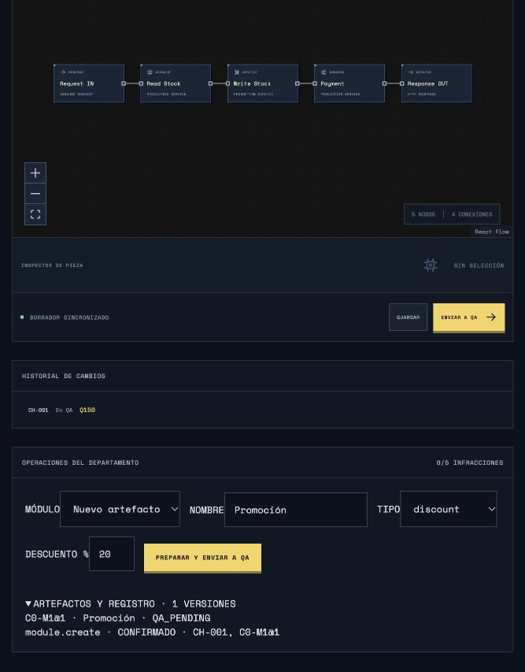

# Entrega 4A — acciones, artefactos, defectos y agentes por rol

## Base y reproducción

Base remota verificada mediante `git fetch origin codex/entrega-3-clientes-migracion-fidelizacion`: **b3996dfd1650aefcc85b4b4ce95042b8cfb2b185**. La rama local y la remota coincidían y el árbol estaba limpio. Se leyeron los documentos 07, 08 y 09 y se reprodujeron las **115 pruebas** antes de implementar. No hubo desviación de base, merge ni cambios en `main`. Ruflo no se utilizó.

Rama de trabajo: `codex/entrega-4a-motor-acciones-defectos`. Los commits A–I separan contratos, infraestructura, artefactos, defectos, QA, bloques, negocio, disciplina y adaptador. El corte J reúne migración, proyecciones, controles visuales, regresiones y mediciones.

```sh
npm test
npm run build
npm run bench:traffic
npm run bench:actions
npm run bench:connections
```

Los benchmarks simulan el tiempo completo mediante ticks de 100 ms; no esperan 20–25 minutos de reloj. Requieren Node con `node:sqlite`, como la base. Guardan evidencia en `artifacts/`; los informes de esta entrega se versionan en `docs/benchmarks/`. Cada resultado declara duración alcanzada, semilla, escenarios, comandos, muestras, solicitudes archivadas y mediciones. El sandbox de desarrollo exige permiso para los sockets locales de `tsx` y de las pruebas HTTP; esto no es una dependencia adicional del producto.

## Un único despachador

`shared/actions.ts` define el catálogo y la unión discriminada `SimulatedAction`, versión **1**. `server/action-validation.ts` valida tipos exactos, parámetros desconocidos, números finitos, rangos, enums, dependencias y límites de recursos. No acepta código, SQL, propiedades arbitrarias de `GameState` ni un rol suministrado por el cliente.

Todos los botones conservan el protocolo `Command`. La entrada estructurada lo envuelve así:

```json
{
  "id": "id-de-transporte",
  "type": "action.execute",
  "payload": {
    "action": {
      "version": 1,
      "id": "orden-backend-001",
      "companyId": 0,
      "source": "fixture",
      "type": "module.create",
      "parameters": {
        "name": "Cupón de bienvenida",
        "configuration": {
          "kind": "coupon",
          "percent": 20,
          "audience": "new",
          "stackable": false
        },
        "dependencies": []
      }
    }
  }
}
```

Socket.IO obtiene la identidad de la cookie HttpOnly consultada en SQLite. `applyCommand` → `dispatchCommand` verifica empleado, idempotencia, catálogo, rol y empresa antes de llamar al ejecutor original. La entrada estructurada termina en ese mismo camino. `source`, `requestedAt` y `correlationId` son metadatos; no conceden autoridad ni determinan el reloj del motor. `changeId` puede ir en el sobre; `qa.execute` lo lleva en sus parámetros estrictos.

La idempotencia se identifica por empleado e ID de orden, con digest canónico. Repetir ID y contenido devuelve el recibo anterior; cambiar su contenido devuelve `ID_CONFLICT`. Cambiar solamente el ID de transporte no repite la acción interna. Los comandos de UI también pasan ahora por este guard. Los helpers antiguos de pruebas usaban siempre `test`; se actualizaron a IDs consecutivos y reproducibles por partida. La tabla SQLite de comandos sigue confirmando recibo y snapshot en una transacción.

| Rol | Operaciones exclusivas |
| --- | --- |
| Backend | `module.create`, `module.revise`, borrador y envío de grafo Backend |
| Seguridad | `security.prepare`, borrador y envío de grafo Seguridad |
| QA | `qa.run`, `qa.execute`, aprobación y rechazo humanos |
| CTO | Autorización/rechazo de cambios, presupuesto, prioridad, autorización/rechazo de campañas |
| DevOps | Escala, balanceador, reinicio individual/total, detener/recuperar servicios y despliegue autorizado |
| Producto | Propuestas de funcionalidad, preparación y activación de campañas autorizadas |
| Docente (`operator`) | Control de sala y corrección administrativa justificada |

`draft.save` y `change.submit` deducen el dominio del rol autenticado. El catálogo completo es el objeto `ACTION_CATALOG`; no existe un registro independiente para agentes.

## Artefactos y publicación

`server/artifacts.ts` almacena versiones inmutables por empresa. Cada versión conserva configuración discriminada, dependencias con versión, grafo, perfil de generación, autor, tick, cambio y defectos internos. Crear o revisar prepara un cambio **QA_PENDING** y un nodo `module` conectado en una ruta real. No modifica producción. Una revisión conserva el tipo del módulo y produce una versión nueva.

| Tipo | Configuración y efecto |
| --- | --- |
| `discount` | Porcentaje entero 0–70, público `all/new`, apilamiento explícito. Cambia el precio en la ruta antes de pagar. |
| `coupon` | Igual contrato; exige al menos un cupón. Los cupones repetidos del mismo módulo se aplican una vez en la implementación correcta. |
| `inventory` | Mínimo 1–120, validación de entradas y liberación de reservas interrumpidas cuando la implementación lo cumple. Una comprobación previa no es atomicidad. |
| `purchase` | Procesamiento con idempotencia configurable, validación de autorización/inyección simulada y política de reservas. |
| `concurrency` | Estrategia `unsafe`, `atomic` o `lock`, ejecutada sobre el inventario real de la cohorte. |

Una dependencia debe pertenecer a la empresa y estar conectada en la versión candidata. No se publica implícitamente un módulo pendiente para satisfacer otra dependencia. Los límites son 40 módulos, 30 trabajos activos por empresa y los 25 nodos/30 conexiones del grafo. Una funcionalidad no representable se rechaza sin afirmar que se creó.

Backend/Seguridad → QA → CTO → DevOps → producción sigue siendo obligatorio. QA debe terminar una prueba; los resultados no aprueban nada. CTO reserva el costo. DevOps inicia `rolling` (6 s) o `restart` (3 s). La publicación cobra una vez y congela un `ExecutionRelease` para nuevas admisiones. Las solicitudes en vuelo conservan ruta, versión, configuración y defectos anteriores; una edición posterior no modifica esos objetos.

El precio base permanece en **Q45**, costo por unidad legítima **Q42** y compensación por sobreventa **Q8**. Un descuento de 20% cobra Q36 y aporta **Q−6** por unidad respaldada. Un no elegible conserva Q45. La sobreventa no crea ingreso legítimo adicional. Los cobros repetidos se contabilizan como anomalías y compensación Q8, sin fabricar ventas legítimas ni ingreso adicional. Una reserva terminal no pagada solo se libera cuando lo implementa su módulo; los compromisos pagados nunca se borran por reiniciar servidores.

El tráfico tiene combinaciones comerciales reproducibles: una de cada diez admisiones lleva dos cupones; las demás, uno. Esto permite que un defecto latente se manifieste en operaciones normales. La elegibilidad de cliente nuevo se congela al admitir: todavía no tenía visitas satisfactorias. La semilla y los contadores determinan el tráfico; ningún resultado depende de FPS o de un modelo de lenguaje.

## Defectos persistentes

`defects-1` genera defectos **al crear/revisar**. La semilla incorpora semilla de sala, identidad local del artefacto, versión, configuración, dependencias y perfil. El namespace corporativo se normaliza: el mismo trabajo inicial en las cinco empresas recibe los mismos sorteos, evitando ventaja por índice. No se utiliza `Math.random`. Cada candidato tiene probabilidad 0.18, incrementada por dependencias/apilamiento y acotada a 0.65. Existen versiones con cero, uno o varios defectos; no hay una cantidad fija.

| Defecto | Activación y consecuencia real | Cobertura que lo reproduce |
| --- | --- | --- |
| D01 | La implementación de concurrencia omite su protección; lecturas intercaladas pueden producir compromisos excesivos. Otro Atomic conectado todavía puede proteger. | Compras concurrentes con stock limitado; una unidad aislada puede pasar. |
| D02 | Compra elegible con dos cupones: aplica dos veces el porcentaje del módulo. | Integración comercial; un cupón básico no lo activa. |
| D03 | Implementación idempotente omite el guard; una intención repetida compromete/paga otra vez. | Duplicados y reintentos con la misma intención. |
| D04 | Inventario acepta una entrada marcada inválida. | Casos de límites/entradas inválidas. |
| D05 | Procesamiento permite autorización falsificada si no lo detiene autenticación u otro control efectivo. | Entrada `forged` de seguridad. |
| D06 | Con 32 solicitudes esperando añade 1,500 ms al módulo. | Carga; casos aislados no producen la demora. |
| D07 | Interrupción de una reserva no pagada deja un compromiso pendiente. | Fallo/recuperación después de Write. |
| D08 | Procesamiento acepta inyección sintética si no hay un WAF efectivo. | Entrada `injection`. No se ejecuta SQL malicioso. |

La severidad, relación artefacto-versión y cobertura están en `DEFECT_CATALOG`. Los estudiantes reciben diferencias observadas de los casos solicitados, no `defects`, códigos de activación, paquetes de ejecución ni la lista de errores latentes. También la proyección del Docente excluye esos secretos técnicos; conserva los registros administrativos.

## QA ejecutable

`server/qa.ts` implementa unitarias, integración, concurrencia, carga, seguridad y regresión. `qa.execute` acepta el contrato completo de `TestScenario` definido en `shared/actions.ts`. Límite: **1–500 solicitudes**, stock 0–2,000, concurrencia 1–n, 0–3 cupones y 0–5 timeouts de pago inyectados. Las solicitudes de recursos fuera del límite se rechazan antes de empezar.

```json
{
  "changeId": "CH-001",
  "scenario": {
    "suite": "concurrency",
    "requests": 200,
    "stock": 1,
    "concurrency": 200,
    "retries": 0,
    "duplicateIntent": false,
    "coupons": 1,
    "newCustomer": true,
    "invalidInput": false,
    "attack": "none",
    "interrupt": false
  }
}
```

Los casos de concurrencia usan el mismo `advanceConcurrency`/`executePurchaseOperation` de LAST-UNIT, con la cantidad declarada, grupos intercalados e inventario propio. Carga admite todas las solicitudes en el ejecutor de tráfico, colas FIFO y capacidad de staging. Las otras suites ejecutan operaciones concretas del mismo intérprete, con sus entradas elegidas. `retries` declara respuestas de pago interrumpidas: solo una pieza Retry conectada puede reintentarlas y sus límites/deadline siguen vigentes. El informe declara intentos efectivamente realizados.

El oráculo calcula precio y aceptación esperados con la configuración contractual, stock, público, cantidad, intención y entradas; no consulta los defectos para decidir si una prueba pasa. Contrasta compromisos, pagos, precio, reservas pendientes y duplicados. La evidencia contiene cada resultado, entrada, hash, duración y número de operaciones; 200 significa 200 registros ejecutados. Los casos pueden pasar con defectos no cubiertos.

Las copias de staging usan identidades `qa`, capacidad y dinero propios, no referencias del mercado real. Los jobs avanzan diez subpasos de 100 ms por tick de sala, comparten **un trabajador QA por empresa** y sobreviven a snapshots. Pausar congela reloj, deadlines y ejecución. CTO elige qué dominio obtiene primero ese recurso; no modifica resultados ni repara módulos.

Los botones antiguos de Concurrencia y Carga conservan sus fixtures compatibles. Las demás suites usan el nuevo ejecutor; se retiró de ese camino la antigua estimación agregada `inventoryBatch`. Esta función permanece para compatibilidad de sus fixtures históricos, sin autoridad sobre producción.

## Bloques avanzados

`shared/blocks.ts` define configuración tipada opcional `node.data.config`. Los grafos de la UI anterior siguen usando su valor numérico: el intérprete deriva defaults sin congelar un valor que impida editarlo. Configuración explícita incompatible se rechaza. Una pieza desconectada no ejecuta nada.

| Pieza | Semántica |
| --- | --- |
| Lock | Mutex de `stock` o `payment`, adquisición 0–5,000 ms, TTL 100–30,000 ms. Espera sin avanzar el cursor. Stock libera al escribir; pago al pagar; un terminal libera recursos restantes. Un lock tardío no corrige lecturas anteriores; el TTL puede vencer bajo contención. |
| Queue | Buffer FIFO acotado 1–500 del tramo de stock, una cabeza hasta Write/terminación. Lleno rechaza. Comparte la capacidad real de infraestructura; no genera servidores ni solicitudes. |
| Retry | Solo timeout de pago, 1–6 intentos totales, delay 100–5,000 ms y deadline individual. Un reinicio total puede interrumpir una respuesta ya pagada y provocar reintento si aún cabe en el deadline. |
| Idempotency | Intención de compra, nodo conectado y TTL 1–300 s. Protege el tramo posterior; no revierte una escritura anterior. La expiración puede permitir repetición. |
| Cache | Stock/versión de un SKU, TTL 1–300 s, capacidad 1–64, hits, misses y expiración. Puede invalidar al escribir si se configura. Un hit evita trabajo del servicio de lectura; puede servir stock obsoleto. |
| Validation | Mínimo 1–120 y rechazo opcional de entrada inválida, en el instante del nodo. No bloquea ni concede atomicidad. |

Se modela un único recurso de stock por cohorte, no un grafo de deadlocks generales ni múltiples SKUs arbitrarios. Queue serializa su tramo de stock; no es un broker distribuido. Retry no reejecuta arbitrariamente toda la transacción: repite el pago incierto. Estas restricciones son parte del comportamiento implementado, no soporte futuro anunciado como presente.

## Infraestructura y seguridad

Cada instancia tiene estado UP/RESTARTING y un tick de retorno. Con balanceador, las instancias UP suman capacidad; sin él se usa APP 1. Reiniciar una entre cuatro deja tres; reiniciarlas todas deja cero. Se permite duración 1–60 s y parada/recuperación de un servicio concreto. Colas, reservas, pagos y deadlines siguen existiendo durante la indisponibilidad. La mala decisión no añade infracciones. No se crean procesos ni contenedores por instancia.

Los controles preparados por Seguridad se publican por el mismo pipeline y se congelan en las siguientes admisiones. Incluyen auth, autorización de solicitudes simuladas, WAF, umbral de bots, lista de orígenes sintéticos y rate limit. Auth del videojuego/sesión nunca se debilita por esos controles de la simulación.

Rate limit cuenta solicitudes reales por origen/cliente, ventana fija 1–300 s, límite 1–10,000, alcance todas/compras y rechazo al exceder. `sim-0`…`sim-79` son grupos sintéticos reproducibles; no son IPs de estudiantes. Las piezas Rate antiguas usan su valor por segundo/origen en admisión. Una ventana de 20/minuto admite 20 y rechaza la 21; no aplica un porcentaje estimado de reducción de tráfico. También LAST-UNIT atraviesa los controles efectivos.

## CTO, Producto y disciplina

Producto prepara campañas de 10–300 s, presupuesto Q1–2,000, descuento 0–70% y multiplicador de interés 1–4. CTO reserva financiación con vencimiento 120 s. Solo Producto activa una campaña autorizada; se cobra el presupuesto una vez. Solo puede haber una activa por empresa. Durante su ventana aumenta las llegadas legítimas y aplica la oferta a compras elegibles; el ingreso depende de pagos reales. La campaña puede llenar colas, provocar abandonos y deteriorar experiencias. Las propuestas de funcionalidad son trabajos comerciales registrados, sin editar Backend.

`discipline-1` conserva 30 puestos de seis roles. Una acción conocida inequívocamente ajena al rol o a otra empresa añade una infracción confirmada. Una interpretación mal formada, desconocida, ambigua o fallida no la añade. El único caso fuera del juego automáticamente confirmable en este adaptador es una petición exacta de escribir un poema, verificada contra texto original y regla anclada versionada; la clasificación del modelo por sí sola carece de autoridad disciplinaria.

Cinco IDs distintos confirmados → **EXPELLED**. Reintentar el mismo ID no aumenta el contador; IDs conflictivos no ejecutan nada. Se bloquean órdenes por esa sesión/puesto y nuevos logins, incluso después de reiniciar. La sesión existente puede leer su situación, pero pierde toda capacidad operativa. Otro actor no puede asumir el departamento. El resto de la empresa y los trabajos previamente autorizados siguen sus estados normales.

Docente puede ejecutar `employee.correct` con empleado y justificación obligatoria: revierte la última infracción confirmada, conserva el registro con `reversed`, reactiva el puesto y deja auditoría con motivo. No existe botón de restitución estudiantil. El audit registra identidad autenticada, tipo, fuente, versión, resultado, referencias, deltas de recursos y sanción. Las terminaciones QA, publicación y recuperación de instancias añaden eventos de confirmación del motor.

La sala admite 12,000 órdenes auditadas antes de rechazar nuevas órdenes con `LIMIT` (restablecer continúa disponible). Los límites Socket.IO/JSON y del simulador son independientes de futuros límites del proveedor.

## Esquema 5 y recuperación

Se preserva la cadena 1 → 2 → 3 → 4 y se añade 4 → **5**. El servidor archiva el JSON original de esquemas 1–4 antes de la primera escritura. Las partidas de versiones anteriores obtienen empleados activos y runtime vacío; no se inventan infracciones, módulos, campañas, cobros o experiencias antiguas.

Se conservan mercado, 5,000 clientes, migraciones, fidelidad, referencias activas, inventarios, solicitudes, contabilidad, colas, artefactos/versiones/defectos, jobs, despliegues, estados de instancias, ventanas de rate limit, campañas/reservas, prioridad, empleados, auditoría y recibos de idempotencia. RUNNING recupera **PAUSED**. Los relojes son de simulación y no consumen duración mientras el proceso está detenido.

Las solicitudes antiguas sin versión de intérprete se marcan `requests-1`, manteniendo su semántica congelada; las nuevas usan `requests-4a`. Los cambios pendientes antiguos que contienen piezas cuya semántica ahora se amplía vuelven a QA, invalidan evidencia anterior y liberan reservas. No se actualizan retrospectivamente operaciones en vuelo.

Los paquetes de ruta/ejecución de tráfico se serializan una vez por release y se reconstruyen al recuperar. La población no se duplica en Company ni se envía en snapshots. Los recibos terminales omiten defectos y permanecen en SQLite; la poda en memoria conserva las invariantes anteriores. Los mapas operativos con TTL se depuran. Las intenciones que son únicas por construcción no crean entradas de pagos innecesarias; reintentos, módulos de pago e intenciones compartidas sí usan el ledger correspondiente.

Snapshot, recibos y comando se confirman juntos en SQLite. Un cierre abrupto todavía puede perder ticks desde la última escritura periódica; no se promete un journal por tick. La recuperación vuelve con sus efectos y marcas de conciliación al mismo punto. No hay cargos de Anthropic ni clave API.

## Verificación manual

```sh
FLOW_PORT=4189 FLOW_DATA_DIR=/private/tmp/flow-war-4a-manual npm run dev
```

Abrir `http://localhost:4189`, usar las credenciales de esa carpeta en perfiles/dispositivos separados. `/control` es Docente; `/workspace` conserva el panel del rol. Los nuevos controles están al final del panel, bajo **OPERACIONES DEL DEPARTAMENTO**.

1. Docente inicia y pausa; comprueba que pausar congela infraestructura y QA.
2. Backend crea descuento/cupón 20%: aparece CH en QA_PENDING y un artefacto; la versión productiva todavía no cambia. También puede crear inventario, compras y concurrencia, o revisar una versión.
3. QA selecciona el cambio y elige Unitarias o un caso personalizado. Para concurrencia: 200 solicitudes, 200 simultáneas, stock 1. Para duplicación: 50, mismo pago, stock 100. Para combinación: dos cupones, cliente nuevo. Observa evidencia, precio esperado/observado y cantidad. Decide aprobar o rechazar.
4. CTO autoriza el cambio probado. DevOps elige estrategia y despliega; el cambio termina DEPLOYED, cambia versión y las siguientes operaciones usan el artefacto.
5. Seguridad prepara 20 solicitudes por origen en ventana 60 s y decide los demás controles. QA/CTO/DevOps repiten el pipeline. Las siguientes admisiones usan los contadores y rechazos reales.
6. DevOps financia capacidad mediante CTO, escala y activa balanceador. Reinicia una APP y luego todas; observa estado por instancia, capacidad, colas, deadlines y retorno. Puede detener/recuperar un servicio.
7. Producto prepara una campaña. CTO la autoriza y Producto activa; observar llegadas, gasto único e ingresos ligados a compras. Registrar una propuesta no crea un módulo.
8. Para verificar disciplina de forma reproducible usar las pruebas de servidor o el adaptador local con Backend + fixture `restart_all` en cinco IDs diferentes. El panel muestra 5/5 y vacante; los controles quedan deshabilitados y el servidor rechaza órdenes nuevas. La empresa continúa.
9. Docente introduce empleado y justificación para corregir una infracción comprobada; el registro conserva su reversión y el motivo.
10. Reiniciar el servidor con su misma carpeta: sala pausada, jobs y reinicios pendientes, población, pipeline y sanciones conservados. Reenviar una orden confirmada conserva su recibo sin repetir efectos.



## Evidencia automatizada y límites

La suite final contiene **181 pruebas: las 115 originales y 66 nuevas** de contratos, roles, infraestructura, artefactos, D01–D08, QA, bloques, negocio, disciplina, intérprete y proceso real autenticado. Las expectativas antiguas de esquema pasan a 5. La prueba que rechazaba Lock como no implementado ahora conserva el rechazo de una pieza desconocida; se añadieron pruebas del Lock ejecutable. Ninguna prueba fue eliminada.

| Requisitos | Evidencia |
| --- | --- |
| T01–T10 | `action-coverage.test.ts`, `actions-contract.test.ts`, `discipline.test.ts`, `action-server.test.ts` |
| T11–T17 | `defects.test.ts`, `artifacts.test.ts`, congelación de releases y privacidad en `action-coverage.test.ts` |
| T18–T24 | `qa-actions.test.ts`, fixtures de 200 compras y 50 pagos con evidencias individuales |
| T25–T29 | `infrastructure.test.ts`, pipeline original, servidor real y `blocks.test.ts` |
| T30–T37 | `blocks.test.ts`, incluidas contención, TTL, FIFO, Retry/deadline, caché obsoleto y validación no atómica |
| T38–T41 | `business.test.ts`, campañas y asignación del worker QA |
| T42–T51 | `discipline.test.ts`, `agents.test.ts` y reinicio del servidor autenticado |
| T52–T60 | Migración esquema 4/5, pruebas originales de persistencia, mercado/LAST-UNIT/FIFO/QA Carga y proyecciones |

Los escenarios A–H y controles, mediciones y comparación se detallan en el informe de benchmarks de esta entrega. Se incluyen causas mediante comandos y muestras; un nombre de escenario no cuenta por sí solo como verificación.

No hay integración Haiku, comprensión general de lenguaje natural, director autónomo, compilador arbitrario, bloqueos distribuidos reales ni procesos por cliente. Las campañas y defectos son reglas educativas tipadas. Las suites cubren lo solicitado; no garantizan descubrir cada defecto. No se aprueban ni reparan cambios automáticamente. La integración posterior se define en [contrato de agentes](11-contrato-agentes-ia.md).
