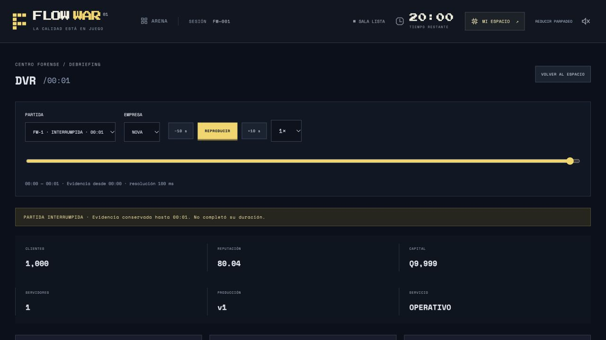
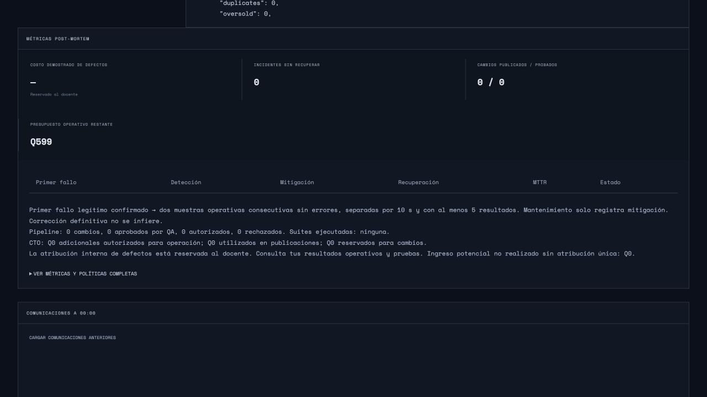

# Auditoría y correcciones de Entrega 5

Referencia verificada: `c86d32058f0fd1741e27e6397f6124a1f1a4b62b`. Rama de trabajo: `codex/entrega-5-audit-fixes`, creada desde ese commit. No se modifica ni fusiona `main` (referencia local inicial `ded62dcba370b899b5295e4e81837a7276b0bc65`). Fecha: 19 de octubre de 2026, zona del usuario America/Guatemala.

## Diagnóstico y reproducciones

Los cuatro hallazgos se confirmaron. `audit-baseline.ts` reproduce el reset RUNNING inaccesible y la exposición de campos del recibo, mide reconstrucción sincrónica y contabiliza páginas SQLite. Los percentiles del ensayo de carga usan rango más cercano; con tres mensajes, p95 y p99 representan el máximo de esas tres observaciones. El benchmark de chat independiente usa 125 mensajes. La primera ejecución de `npm test` aprobó las 213 pruebas originales. Los registros están en `docs/benchmarks/audit-fixes/`, sin credenciales ni bases de partidas.

El primer ensayo de cuatro reconstrucciones consecutivas de 119,9 s registró 498,0 ms de demora de un temporizador y 507,2 ms de demora máxima del event loop. Esto confirma bloqueo en ese escenario; no demuestra por sí solo la degradación de una clase de 31 usuarios. `audit-load.ts` añade un servidor real, partida nueva activa, tres conexiones Socket.IO, dos consultas históricas concurrentes, comandos, chat y ocho cancelaciones HTTP. Las mediciones finales comparables constan en los JSON de carga. El ensayo usa una generación histórica de 120 s y una nueva de 1500 s, velocidad 1. Se añade una variante con historial completo de 1200 s y partida activa avanzada realmente hasta 900 s, a velocidad 20.

Para repetir la versión anterior, extraer el commit de referencia a un directorio temporal y copiar allí los scripts de auditoría; usar las mismas dependencias instaladas. El servidor de referencia permanece intacto. `--require` instala instrumentación temporal en el proceso servidor: monitor del event loop de 10 ms, intervalos de 100 ms, duración de sus callbacks y transacciones BEGIN/COMMIT. No altera el motor ni añade endpoints administrativos. El heap medido es el del hilo principal; RSS incluye el proceso completo y los workers.

## H1: interrupción y continuidad histórica

**Causa:** el reset reemplazaba `GameState`, borraba el buffer anterior y solo persistía metadatos RUNNING/PAUSED; `historyAccess` admitía únicamente FINISHED. El persist previo al reset tampoco formaba una transacción con la nueva generación.

**Solución:** se conserva una copia de la generación anterior con sus buffers. Las solicitudes pendientes se cancelan en el mismo tick con `ROOM_INTERRUPTED`, preservando el comportamiento previo de liberación y liquidación del trabajo admitido. Esa cancelación administrativa no produce experiencias negativas del mercado ni quejas automáticas, no avanza el reloj y no equivale a completar la partida. Los resultados ya confirmados permanecen intactos. La generación recibe `ABORTED`, `closure` (generación, tick, estado previo, motivo, identidad, hora real) y un evento con ID del comando. Se fuerza un checkpoint SHA-256 verificable al tick y secuencia del cierre. Las partidas ya FINISHED conservan esa condición.

`createGameWriter` usa una sola transacción `BEGIN IMMEDIATE` para escribir generaciones cerradas, recibos, hechos, checkpoints, nueva sala y recibo durable del comando. Solo después de COMMIT vacía buffers y confirma al cliente. En error, SQLite revierte todo y el servidor recupera el estado y buffer anteriores. `synchronous=FULL` y WAL proporcionan la durabilidad configurada de SQLite. La prueba con SIGKILL valida recuperación después de una confirmación; no simula una avería física del dispositivo.

La deduplicación `(identity,id,digest,result)` ya era durable y se conserva entre generaciones y reinicios. Los recibos de comandos sobreviven incluso a la eliminación de una generación. Un ID reutilizado con otro cuerpo se rechaza. También se prueba un trigger que hace fallar la escritura del reset: no hay ACK positivo, no existe generación parcial y el mismo comando puede reintentarse después de retirar el fallo.

El DVR admite FINISHED y ABORTED, limita las solicitudes al último tick real y distingue visualmente la interrupción. El botón de reset explica que se conserva el historial. El acceso al DVR desde el control y el espacio estudiantil permanece visible también durante una partida nueva.

**Compatibilidad:** `sealLegacyGenerations` cierra generaciones anteriores huérfanas únicamente si su último tick durable puede reconstruirse. Las marca `LEGACY_UNCLOSED` sin inventar identidad, hora de interrupción o evidencia faltante. No recupera eventos que la versión anterior nunca escribió. Si faltan checkpoints o una versión de replay no es compatible, falla de manera visible y conserva los datos.

## H2: separación de información observable y evidencia interna

**Causa:** se usaba una lista negativa incompleta para construir recibos y se devolvía directamente el JSON persistido. Había rutas alternativas en las solicitudes de LAST-UNIT, marcadores, estadísticas forenses y etiquetas de partículas.

**Solución:** `projections.ts` contiene contratos positivos para recibos, resultados y hechos. La proyección estudiantil admite identificadores propios, estado, tiempos, etapa, ruta publicada, stock realmente leído, resultado operativo, liquidación y trazas observables. `securityAllowed`, `trafficClass`, `attackKind`, `breach`, activaciones, contratos internos y pérdidas atribuidas a defectos no pasan a esos contratos. Los objetos anidados también se proyectan. Campos futuros desconocidos se mantienen privados por defecto.

Los recibos internos preservan evidencia completa salvo el objeto repetido de la versión publicada: la versión y módulos congelados siguen en checkpoints y hechos del journal. Las proyecciones no modifican esas estructuras. El docente recibe los recibos internos y la evidencia forense autorizada de generaciones cerradas. Las métricas estudiantiles no revelan artefactos con defectos latentes ni atribuciones internas. Los contadores de clasificación de tráfico, la tasa interna de fraude, el contador interno de penetraciones y el diagnóstico `kind: attack` se reservan al operador; permanecen las métricas operativas y el mismo diseño visual.

La autorización de solicitudes usa la empresa de sesión, no parámetros del navegador. Anónimo: 403; otra empresa: 404. En el DVR se verifica también generación cerrada y empresa; los errores de reconstrucción/worker no devuelven errores SQL ni rutas internas. No se modifican cálculos de economía ni generación de tráfico.

Se auditaron `/api/snapshot`, snapshots Socket.IO, `/api/requests/:id` tanto vivo como persistido, LAST-UNIT privado, `/api/flowslack`, marcadores, chat histórico, métricas y evidencia del DVR. Las comunicaciones humanas son contenido introducido por sus autores; las comunicaciones automáticas usan evidencias visibles. No se filtra deliberadamente lo que una persona escribe a su propio equipo.

## H3: aislamiento y control de carga

**Causa:** reconstrucción, lectura de hechos y post-mortem sincrónicos compartían el hilo de ticks, sockets y chat. Envolverlos en una promesa no libera ese hilo.

**Solución:** todos los endpoints DVR ejecutan sus consultas, reconstrucción y construcción de respuesta en `DvrPool`. Cada worker abre su propia conexión SQLite `readOnly`, `query_only`, caché de 8 MiB, sin mmap, y una transacción de lectura por trabajo. Solo recibe consulta e identidad clonadas, nunca la partida activa. El hilo principal mantiene autenticación, admisión y entrega HTTP.

Valores predeterminados: 2 workers, cola global de 8 trabajos, 2 trabajos admitidos por identidad, plazo total de 15 s, heap V8 de 512 MiB por worker más generación joven de 32 MiB. Se permite configurar `FLOW_DVR_WORKERS` entre 1 y 4. Los otros límites están centralizados y validados en `PoolOptions`, con límites superiores; no hay cola ilimitada. Dos workers permiten atender las dos consultas del ensayo; ocho en cola y dos por identidad limitan a diez trabajos globales y evitan que una sola identidad llene la cola. El heap toma como referencia los escenarios originales de Entrega 5, con picos cercanos a 419 MiB, y se valida con escenarios largos; no constituye un límite absoluto del RSS nativo. La aplicación no promete capacidad ilimitada en equipos con poca memoria.

La aceptación temporal del ensayo local exige p99 del event loop menor de 75 ms, intervalo p95 del motor menor de 150 ms y ACK p95 menor de 100 ms: respectivamente menos de un tick, no más de medio tick adicional al intervalo nominal y una confirmación dentro de un intervalo. Para la variante avanzada a velocidad 20 se permite un ciclo nominal adicional en p95 (menos de 200 ms), event loop p99 menor de 150 ms y ACK p95 menor de 150 ms; el margen reconoce el procesamiento y los checkpoints del motor existente. Son presupuestos de estos ensayos locales y no una garantía universal de red o hardware.

Un aborto HTTP elimina un trabajo en cola o termina el worker que lo está ejecutando. No se reutiliza el slot hasta acabar la terminación. Error, salida o timeout rechazan el trabajo de manera visible; los siguientes trabajos crean un worker nuevo. 429/503 incluyen `Retry-After: 1`. Los workers inactivos no mantienen vivo un servidor cerrado. El cierre explícito termina todos los workers.

El cliente conserva debounce de 70 ms y usa `LatestDvrRequest` para abortar transporte y descartar respuestas obsoletas de frames, métricas, inspección y comunicaciones. La paginación de chat queda ligada al frame y filtra mensajes posteriores al instante mostrado. La saturación se distingue de ausencia de evidencia; las métricas ofrecen reintento. Dos pruebas fuerzan respuestas fuera de orden incluso cuando el transporte ignora AbortSignal. Los mensajes de saturación son comprensibles. La prueba del pool compara resultados exactos con `queryDvr`, comprueba temporizadores vivos, límites, cola, cancelaciones y caída/recreación de un worker. Pruebas del servidor ejercitan el modo real `NODE_ENV=production` con tsx; un bootstrap `.mjs` registra el runtime ya existente, sin nueva dependencia.

## H4: almacenamiento, archivo y retención

**Causa:** recibos extensos repetían rutas y trazas; no había generación explícita en recibos/comandos ni operaciones completas de administración. Los checkpoints ya estaban comprimidos. El tamaño lógico de JSON no equivale a páginas físicas.

**Solución de formato:** las rutas se guardan una vez por `(generation,SHA-256)`. Los campos consultados mediante SQLite JSON (`type`, `arrivalAt`, resultado, `waits`, estado y liquidación) siguen siendo JSON. Los otros detalles se comprimen sin pérdida en un BLOB zlib con checksum de la representación original. El decodificador soporta recibos inline heredados, rutas referenciadas sin compresión y `receipt-zlib-1`. El límite de descompresión de detalles de un recibo es 4 MiB; detalles mayores se conservan inline para no crear recibos ilegibles; las rutas, checkpoints y metadatos se conservan aparte. La aplicación genera trazas de tamaño acotado por la ejecución y las pruebas verifican la descompresión y equivalencia.

La primera implementación de compresión concentraba el codec en persistencia y elevó su p95 a 120–175 ms. Se corrigió preparando copias inmutables de los recibos conforme se liquidan solicitudes, con una caché WeakMap que desaparece al liberar el outbox. La transacción sigue escribiendo cada ruta (sin cachear una supuesta escritura durable); se reutiliza la sentencia preparada. Las reconstrucciones silenciosas y el QA aislado no realizan esta preparación. No se agrega estado económico ni se cambia el formato. El piloto B-recovery redujo la persistencia p95 de 170,982 a 50,243 ms, conservando ocho reconstrucciones exactas y el mismo tamaño físico.

La primera alternativa de solo deduplicar rutas redujo payload, pero aumentó un 0,14 % las páginas físicas del ensayo: no se aceptó como mejora. La solución elegida, con compresión de detalles, redujo el mismo conjunto de evidencias de 77.778.944 a 64.802.816 bytes tras VACUUM en ambos casos (16,68 %). No se borró evidencia para obtener esa cifra. `audit-storage.ts` compara hashes de todos los recibos decodificados, produce tres partidas completas de 60 s, mide crecimiento, exporta y vuelve a leer el archivo. Es una prueba de formato; no representa una partida docente de 20/25 minutos. Los benchmarks originales de duración completa se ejecutan por separado.

### Esquema y datos heredados

Se agregan `history_games.closure` y `closedAt`, `request_receipts.generation`, `details`, `detailDigest`, `commands.generation`, `receipt_paths`, índices por generación, y tablas `history_policy`, `history_protection`, `history_archives` y `storage_lease`. `closedAt` es la primera escritura durable que registra el cierre; no inventa una hora simulada.

Las migraciones son aditivas. El guardado sigue aceptando esquemas de partida 1–6. `compact` asigna generación a recibos antiguos solo cuando `history_events.data.requestId` identifica exactamente una generación. Nunca analiza prefijos de IDs. Los recibos sin vínculo inequívoco permanecen íntegros y aparecen como no asignados. Los comandos heredados sin generación permanecen como recibos globales de deduplicación; el journal guarda sus entradas históricas. No se borra esa información ni se supone una relación inexistente.

### Operación administrativa

La CLI requiere la credencial real de operador en `FLOW_ADMIN_CODE`, validada contra `access.json`; rechaza una credencial de estudiante. No publica endpoints destructivos ni expone credenciales. Las operaciones sobre la base viva requieren detener el servidor. `verify`, `read` y `query` de un archivo independiente usan solo lectura y pueden ejecutarse mientras otra partida está activa, manteniendo la autorización docente. Una concesión durable en SQLite serializa la admisión de servidor/administrador; se recupera automáticamente si el PID anterior murió y conserva el bloqueo si no puede probarlo. La prueba incluye un proceso CLI distinto rechazado mientras existe una concesión activa.

Ejemplos (las rutas de exportación son elegidas por el administrador):

```sh
# Configurar FLOW_DATA_DIR y FLOW_ADMIN_CODE de forma local, sin publicarlos.
npm run history:admin -- usage
npm run history:admin -- preview
npm run history:admin -- policy '{"keepGenerations":null,"olderThanDays":null,"deleteEnabled":false}'
npm run history:admin -- protect 0 'Conservar para evaluación'
npm run history:admin -- export 0 /ruta/privada/partida-0.sqlite
npm run history:admin -- verify /ruta/privada/partida-0.sqlite
npm run history:admin -- read /ruta/privada/partida-0.sqlite 10.5
npm run history:admin -- query /ruta/privada/partida-0.sqlite '{"kind":"chat","companyId":0}'
npm run history:admin -- query /ruta/privada/partida-0.sqlite '{"kind":"request","companyId":0,"requestId":"ID_REAL"}'
npm run history:admin -- compact
npm run history:admin -- vacuum
```

No hay umbral de retención ni borrado automático predeterminado. Para habilitar borrado, el docente configura explícitamente `keepGenerations` y/o `olderThanDays`, además de `deleteEnabled:true`. Si ambos criterios están configurados, ambos deben cumplirse. Una fecha heredada desconocida nunca satisface un criterio de edad. `preview` muestra causas de protección, estado del archivo y elegibilidad sin modificar partidas. `unprotect <n>` retira una protección explícita; no evita las demás barreras.

La exportación crea una base independiente de una sola generación: hechos, entradas, checkpoints, puntos, conversaciones, recibos, diccionario de rutas y recibos de comandos asignados. No incluye sesiones, credenciales ni la partida activa. Se publica sin sobrescribir destino, con permisos 0600, fsync, manifiesto por tabla, conteos, SHA-256 del archivo, `integrity_check`, checksums de checkpoints y de cada recibo decodificado, correspondencia de identidad/empresa/ruta y reconstrucción del último tick. Se registra el archivo solo después de verificarlo.

La eliminación requiere archivo registrado y verificado de nuevo, coincidencia exacta del manifiesto con la generación aún almacenada, política habilitada, elegibilidad, ausencia de protección y confirmación del número:

```sh
npm run history:admin -- delete 0 --confirm-generation 0
```

Se prohíbe eliminar la generación actualmente cargada, incluso si está FINISHED, y cualquier generación no terminal. La operación borra todas sus tablas relacionadas dentro de una transacción; un fallo intermedio revierte todo. Los recibos globales de comandos se conservan para no romper idempotencia. El archivo independiente permite recuperar la evidencia mediante `read` y las funciones de consulta/reconstrucción de historial; no se implementa importación en la base viva para evitar colisiones entre generaciones. `vacuum` es explícito y offline: borrar filas por sí solo libera páginas, sin necesariamente reducir el archivo.

### Medición

`usage` informa archivo principal, WAL y SHM, tamaño de página, páginas libres, tablas e índices con `dbstat`, filas por generación, bytes lógicos de hechos y bytes comprimidos de checkpoints. Los payloads UTF-8 (medidos con CAST AS BLOB) y la asignación física se identifican por separado. El campo histórico `journalBytes` del benchmark original mezcla longitud TEXT de SQLite y bytes de checkpoints: se conserva para comparabilidad, pero no se presenta como tamaño físico ni como conteo UTF-8 exacto. La tabla `game` contiene solo el estado actual y puede generar páginas libres al reemplazarse; no se atribuye ese espacio a pérdida de evidencia.

## Pruebas, archivos y límites

Se añadieron trece casos de auditoría: siete de reset, uno de servidor que reúne privacidad/deduplicación/fallo/reinicio, uno de workers con múltiples escenarios, dos de retención/compatibilidad/CLI y dos de concurrencia del cliente DVR. El total esperado es 226, frente a 213 de referencia; se registra el total realmente ejecutado más abajo. No se modificaron expectativas de pruebas históricas ni cifras de benchmarks anteriores. Se conservaron los resultados fallidos intermedios como diagnóstico local; la evidencia versionada corresponde a ejecuciones finales y a la línea base identificada.

Archivos centrales: `engine.ts`, `observability.ts`, `history.ts`, `storage.ts`, `index.ts`, `traffic.ts`, `requests.ts`, `market.ts`, `flowslack.ts`, `postmortem.ts`, `shared/types.ts`, `src/Dvr.tsx` y `src/App.tsx`. Nuevo cliente: `src/dvrClient.ts`. Nuevos módulos de servidor: `projections.ts`, `dvr-query.ts`, `dvr-pool.ts`, bootstrap/worker, `receipt-storage.ts`, `storage-lease.ts`, `history-admin.ts`. CLI, scripts y pruebas se localizan en `scripts/audit-*`, `scripts/history-admin.ts`, `tests/audit-*`. `connection-benchmark.ts` solo admite tipológicamente la ausencia de contadores privados para roles estudiantiles; no cambia ninguna expectativa ni escenario.

Riesgos residuales: los ticks, el guardado del estado vivo y su compresión siguen siendo sincrónicos; H3 separa las consultas históricas, no promete eliminar toda pausa por persistencia. Los workers tienen límite de heap V8, no un límite absoluto de memoria nativa/RSS. La carga medida no reproduce todas las redes ni equipos escolares. Las exportaciones contienen evidencia privada y requieren custodia administrativa. Los checksums detectan corrupción respecto de un manifiesto o digest conocido, no autentican un archivo adversarial cuyo manifiesto también haya sido reemplazado. No se ofrece migración descendente de los nuevos BLOB a un servidor antiguo: los archivos se leen con la versión corregida. Los recibos heredados sin generación inequívoca no pueden reclamarse automáticamente: se prioriza preservar su evidencia. Los recibos de comandos crecen deliberadamente para mantener deduplicación durable. No se implementa importación/restauración sobre la base activa; se proporciona lectura independiente verificada. Un PID reutilizado puede conservar un bloqueo de mantenimiento por precaución, nunca liberar a ciegas una concesión viva.

## Resultados finales y comparación

Un primer ensayo exploratorio con `FLOW_DVR_WORKERS=1` terminó con un timeout de ACK y no conservó diagnóstico suficiente para atribuir la causa. La repetición instrumentada y otra con 200 abortos HTTP concluyeron sin errores. Estas dos reproducciones de diagnóstico compartieron equipo con el benchmark de tráfico y no se usan para comparar latencias. La salida del fallo inicial se conserva como transcripción identificada en `load-one-worker-initial-timeout.txt`; no se afirma una causa raíz que no pudo comprobarse.

La última batería completa de tráfico/mercado, acciones y Entrega 5 usa tres procesos independientes con bases SQLite separadas. Los ensayos de latencia de servidor, conexiones y chat se ejecutan de forma dedicada y secuencial. Los percentiles de las baterías largas concurrentes se informan con esa diferencia metodológica respecto de la referencia histórica; no se presentan como una comparación aislada de velocidad.

Las tablas siguientes proceden de las ejecuciones conservadas. Los JSON grandes se distribuyen comprimidos sin pérdida con SHA-256 de ambas representaciones, sin reemplazar las referencias históricas de Entrega 5.

Para comparar con el informe publicado anterior, `audit-report.mjs` reproduce exactamente la selección de muestras, campos de empresa y tipos de acción de `scripts/entrega5-report.mjs`: la referencia guardaba cinco muestras frente a las cuarenta/cincuenta de la nueva salida completa. Los estados finales y métricas forenses se comparan completos, y los 176 hashes de estado se comparan sin normalización. No se alteran las referencias históricas.

## Resumen de aprobación y evidencia

| Hallazgo | Causa raíz | Corrección validada | Evidencia | Estado |
|---|---|---|---|---|
| H1 | Reemplazo del estado y DVR limitado a FINISHED | ABORTED, cierre/checkpoint y nueva sala atómicos, deduplicación durable | audit-reset, audit-server, SIGKILL y fallo SQL | Confirmado y corregido |
| H2 | Lista negativa y proyecciones alternativas incompletas | Contratos positivos por rol; evidencia privada conservada | audit-server, enum IDs, snapshot HTTP/Socket, recibos y DVR | Confirmado y corregido |
| H3 | Reconstrucción sincrónica en el hilo de simulación | Workers de lectura, límites, cancelación real y protección de todas las consultas del cliente | audit-workers, audit-dvr-client, carga dedicada corta y completa | Confirmado y corregido en las cargas medidas |
| H4 | Duplicación y falta de administración por generación | Codec reversible, preparación incremental, archivo verificado y retención explícita | audit-retention, audit-storage, CLI, reapertura y rechazo de corrupción | Confirmado y corregido |

La versión final ejecutó **226 pruebas aprobadas, cero fallos**, y compiló correctamente. Las 13 pruebas añadidas reúnen múltiples escenarios/assertions. La referencia ejecutada inicialmente aprobó 213. Los 22 escenarios completos produjeron **176 reconstrucciones exactas** y los 176 hashes coinciden literalmente con la referencia. Los estados económicos, métricas forenses, acciones y muestras comparables también coinciden. No se modificó ninguna expectativa histórica.

| Ejecución requerida | Resultado | Registro |
|---|---|---|
| `npm test` | Exit 0 | [Salida](benchmarks/audit-fixes/tests.txt) |
| `npm run build` | Exit 0 | [Salida](benchmarks/audit-fixes/build.txt) |
| `npm run bench:traffic` | Exit 0 | [Salida](benchmarks/audit-fixes/traffic.txt) |
| `npm run bench:actions` | Exit 0 | [Salida](benchmarks/audit-fixes/actions.txt) |
| `npm run bench:connections` | Exit 0 | [Salida](benchmarks/audit-fixes/connections.txt) |
| `npm run bench:chat` | Exit 0 | [Salida](benchmarks/audit-fixes/chat.txt) |
| `npm run bench:entrega5` | Exit 0 | [Salida](benchmarks/audit-fixes/entrega5.txt) |

La compilación conserva la advertencia de Vite sobre un chunk mayor de 500 kB; no es un fallo de compilación.

## Rendimiento medido antes/después

Entorno: Apple M5, Node v25.9.0, también indicado en la referencia histórica. La comparación dedicada siguiente usa 3 conexiones, 2 consultas DVR concurrentes, 24 consultas exitosas, 3 mensajes entregados y 8 abortos HTTP por ejecución. El historial terminó naturalmente en 1200 s y la nueva partida se simuló realmente hasta 900 s antes de medir, a velocidad 20. Los valores triples son **p50 / p95 / p99**, en milisegundos.

| Medida dedicada | Commit de referencia | Versión corregida |
|---|---:|---:|
| Confirmaciones de comandos | 579.44 / 654.82 / 1412.04 | 69.88 / 113.08 / 131.61 |
| Confirmaciones de chat | 805.24 / 892.66 / 892.66 | 59.94 / 110.40 / 110.40 |
| Reconstrucción completa por HTTP | 1403.90 / 1536.64 / 1570.49 | 773.51 / 982.49 / 983.05 |
| Retraso del event loop | 733.48 / 822.61 / 1562.38 | 12.00 / 62.59 / 110.03 |
| Intervalo de callbacks del motor (nominal 100 ms) | 749.37 / 842.42 / 1619.07 | 101.72 / 158.73 / 202.26 |
| Callback del motor, incluidos ticks/persistencia | 19.45 / 46.79 / 49.22 | 27.98 / 72.71 / 120.09 |
| Transacciones de persistencia | 27.35 / 39.09 / 46.06 | 37.13 / 88.44 / 105.12 |
| Heap principal máximo muestreado (20 ms) | 227.28 MiB | 121.18 MiB |
| RSS máximo muestreado del proceso completo | 579.50 MiB | 802.89 MiB |
| Errores / timeouts detectados | 0 | 0 |

La reducción del bloqueo requiere memoria adicional para aislar reconstrucciones; el RSS incluye los workers y el heap principal no. No se presenta la disminución de heap principal como una disminución de memoria total. Las tres observaciones de chat de este ensayo no representan por sí solas un percentil poblacional estable.

| Medida de batería larga | Referencia histórica | Nueva batería (hasta 3 procesos) |
|---|---:|---:|
| Tick individual de 0,1 s, B-recovery/1200 (p50/p95/p99 ms) | 0.80 / 2.66 / 3.59 | 1.17 / 3.31 / 4.43 |
| Persistencia, mismo caso (p50/p95/p99 ms) | 34.28 / 60.47 / 75.51 | 36.94 / 69.94 / 88.61 |
| SQLite, mismo caso | 556.07 MiB | 425.69 MiB |
| SQLite, intervalo de 22 escenarios | 340.72 MiB–706.41 MiB | 280.55 MiB–532.47 MiB |
| Heap máximo muestreado de batería/GC | 418.52 MiB | 224.84 MiB |
| Máximo `journalBytes` (métrica histórica, no tamaño físico/UTF-8 exacto) | 127903689 | 127903689 |

La preparación incremental se validó además en un piloto dedicado: persistencia p95 **50.243 ms**, frente a 170,982 ms de la implementación intermedia y 60,471 ms de la referencia. Conserva ocho hashes exactos y 425.69 MiB. Los tiempos de baterías largas concurrentes no se usan para afirmar una ganancia aislada de CPU; se conservan todos los percentiles por caso en `comparison.json`.

La prueba de conexiones utilizó **27 conexiones** y obtuvo ACK p95 **207.72 ms**. La prueba de chat utilizó **27 conexiones, 125 mensajes y 125 entregas**, exactamente una vez, con aislamiento, reconexión y reinicio. Su ACK p50/p95/p99 fue **15.81 / 26.11 / 29.31 ms** y entrega p50/p95/p99 **18.02 / 28.19 / 30.93 ms**. No se confunde este ensayo con la carga DVR de tres clientes.

## Uso físico de almacenamiento

Perfil de tres partidas completas de 60 s, después de compactar y aplicar VACUUM. Las columnas de datos e índices proceden de `dbstat`. El mismo conjunto íntegro de recibos ocupa 74.18 MiB inline y 61.80 MiB comprimido: **16.68 % menos**.

| Tabla | Páginas físicas de datos (bytes) | Índices (bytes) |
|---|---:|---:|
| `game` | 4136960 | 0 |
| `request_receipts` | 39473152 | 929792 |
| `commands` | 4096 | 8192 |
| `history_games` | 4096 | 0 |
| `history_events` | 17518592 | 1716224 |
| `history_inputs` | 4096 | 4096 |
| `history_checkpoints` | 839680 | 8192 |
| `history_points` | 45056 | 4096 |
| `slack_messages` | 65536 | 16384 |

WAL: 0 bytes después del checkpoint explícito; SHM: 163840 bytes; páginas libres: 0; página: 4096 bytes. Payload UTF-8 de hechos: 14572176 bytes; checkpoints comprimidos: 824916 bytes. La tabla de rutas y todas las tablas administrativas adicionales constan en `storage.json`.

| Generaciones guardadas | Archivo SQLite antes de VACUUM final |
|---:|---:|
| 1 | 26.57 MiB |
| 2 | 45.69 MiB |
| 3 | 64.89 MiB |

No se extrapola esta prueba corta a la duración docente. Los archivos de 20/25 minutos se midieron en los 22 escenarios completos.

## Verificación visual y reproducción independiente

Se usaron salas temporales con credenciales ficticias. Se comprobó el acceso del docente desde LOBBY, las etiquetas FINISHED/INTERRUMPIDA, el selector estudiantil limitado a NOVA, saltos rápidos 0,1 → 1,1 → 0,6, un recibo propio seguro y el costo interno reservado al docente. Las capturas conservan su formato JPEG real. Las pestañas, servidor y temporales propios se cerraron/limpiaron.





```sh
node scripts/audit-report.mjs
# Lee JSON o JSON.gz y verifica SHA-256 antes de comparar.
```

`compressed-evidence-manifest.json` conserva hashes de datos originales y comprimidos. Los resultados completos permanecen sin pérdida en JSON gzip; no se publican bases SQLite. `comparison.json`, `runs.json`, `final-verification.json`, `visual-verification.json` y las salidas TXT permiten revisar cada conclusión.

## Versiones Git y alcance de validación

Código del benchmark de motor: `d0b3fe47cd065b172e681192f99db651aed138b9`. Última revisión funcional de código validada: `e1d57dfaac77c6667cb0586e1c2c8eeaec2707fc`. Después del benchmark del motor se reforzó únicamente la validación administrativa de archivos y la cancelación/navegación del cliente; el motor, almacenamiento transaccional y workers medidos permanecen iguales. Estos ajustes finales cuentan con pruebas específicas y la suite completa de 226 pruebas.

Rama: `codex/entrega-5-audit-fixes`. SHA inicial: `c86d32058f0fd1741e27e6397f6124a1f1a4b62b`. `main` local y remota conserva `ded62dcba370b899b5295e4e81837a7276b0bc65`. La publicación se limita a esta rama, sin merges. El SHA del commit final que contiene este informe se comunica con la entrega y se comprueba con `git rev-parse HEAD`.

Commits previos al cierre del informe:

```text
1013622 test(audit): reproduce reset and receipt leaks and measure replay contention
8041713 fix(history): atomically preserve interrupted generations on room reset
11a636b fix(privacy): allowlist student evidence and preserve private forensic receipts
ac8bd8d fix(dvr): isolate forensic queries in bounded cancellable read-only workers
6509012 fix(regression): retain observed stock reads and settle interrupted work at the actual tick
3b810bc feat(history): add lossless receipt compression and verified offline retention administration
85ef1b1 test(audit): complete regression and instrument live cadence and storage admission
f47dec7 fix(privacy): close aggregate diagnostic channels and verify complete audit regression
4f6ccbd feat(history): inspect archived conversations and request evidence without restoring live data
e01e100 fix(storage): count logical JSON payload in UTF-8 bytes
a914d0a fix(history): allow authorized read-only archive inspection while the room is active
d0b3fe4 perf(storage): prepare immutable receipts incrementally and keep replay free of codec work
6dc858a fix(archives): verify every receipt checksum before accepting an export
3e5dc2b fix(dvr): cancel obsolete auxiliary queries and keep the latest evidence visible
e1d57df fix(history): keep student DVR navigation available after resetting the room
```

[Revisar la rama publicada](https://github.com/imanderrrrr/flow-war/tree/codex/entrega-5-audit-fixes).
