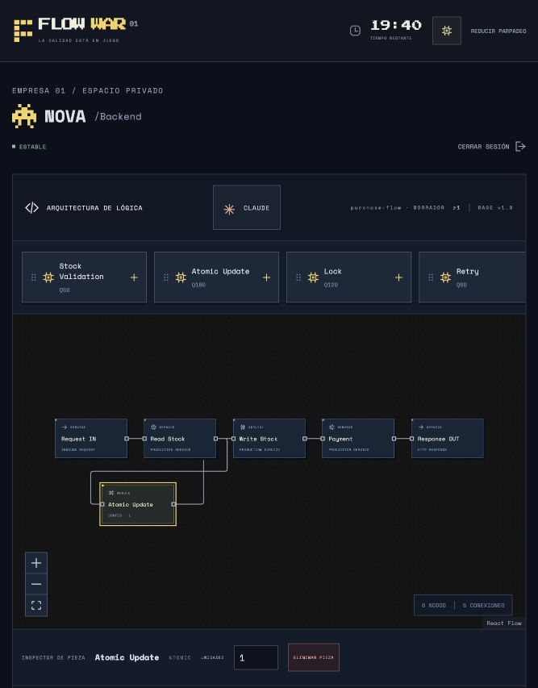
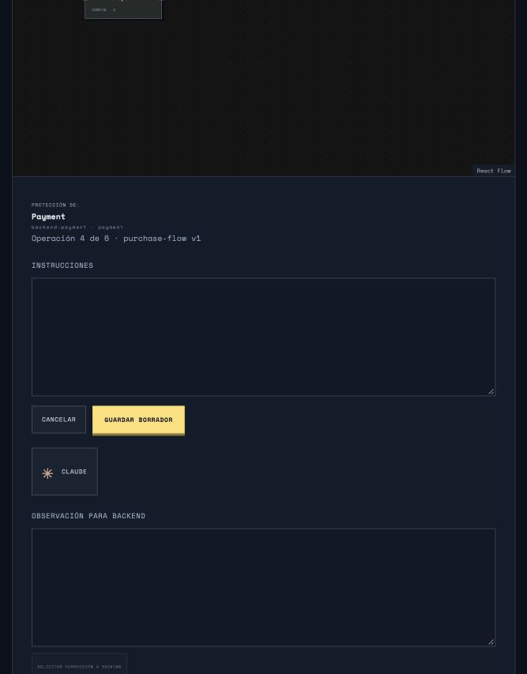

# Evidencia — Entrega 6

Base `develop`: `c57bfb7a64bf429bfa44dca4b5ead170a197372e`.
Fuentes servidor/shared de ambas mediciones finales:
`0bbb5d889418f1ebdef4078d07474c12f80a1c46fcf6cb1825f5c4ea7abfa8b9` (SHA-256 del manifiesto incluido).
No se modificaron esas fuentes durante las mediciones.

## Pruebas

- [Suite completa](tests.log): **285 aprobadas**, cero fallos, omitidas o canceladas; 54.17 segundos.
  Incluye los 264 casos anteriores y 21 casos nuevos de colaboración, IA y HTTP.
- [Build de producción](build.log): TypeScript y Vite correctos.
- Proveedor real: **no probado**; el entorno carece de clave/modelo Anthropic.
- Proveedor simulado y transporte HTTP simulado: contratos, rechazo de salidas inválidas,
  errores, reintentos acotados, cuotas, concurrencia, aceptación/rechazo y políticas ejecutables.
- Servidor HTTP real: proveedor ausente, permisos, origen, límites, sesiones y expulsión;
  31 identidades autenticadas desde una IP, manteniendo el límite de 30 credenciales fallidas.
- DVR ON/OFF, recuperación transaccional, economía y aislamiento: suite completa.

## Aula completa, 1,200 segundos simulados a velocidad 20

Hardware registrado: Apple M5, 10 núcleos, 16 GiB RAM; Node v25.9.0.
Los valores de CPU corresponden al proceso servidor, como porcentaje de un núcleo;
RSS incluye los segmentos antes y después de SIGKILL.

| Métrica | 27 conexiones | 32 conexiones |
|---|---:|---:|
| Estudiantes + docente + proyector | 25 + 1 + 1 | 30 + 1 + 1 |
| Resultado | aprobado | aprobado |
| DVR del benchmark | OFF | OFF |
| Duración de pared, con pausas | 70.65 s | 72.16 s |
| ACK no chat p95, sin espera programada | 1,020.90 ms | 1,020.29 ms |
| ACK chat p95, sin espera programada | 1,618.45 ms | 1,904.64 ms |
| CPU media por segmento | 44.15–51.72% | 44.76–55.64% |
| RSS máximo | 405.44 MiB | 467.59 MiB |
| Bytes lógicos recibidos | 321.15 MiB | 380.82 MiB |
| TCP recibido, con compresión | 43.17 MiB | 51.22 MiB |
| Mensajes humanos únicos | 125 | 150 |
| Entregas privadas verificadas | 625 | 900 |
| Pérdidas / fugas | 0 / 0 | 0 / 0 |
| Recuperación SIGKILL | exacta | exacta |
| Sesiones reutilizadas tras reinicio | 26 | 31 |

Datos completos: [27 conexiones](classroom-27-off-final.json) y
[32 conexiones](classroom-32-off-final.json).

Ambos escenarios conservan cinco empresas y 5,000 clientes. Ejecutan Backend → Seguridad → QA → CTO →
DevOps, otra revisión estructurada compatible, cambios de infraestructura, mensajes privados deduplicados,
reconexión de cliente, mantenimiento y una prueba QA pendiente durante SIGKILL. La recuperación compara
exactamente empresas, mercado, cambios, acciones, FlowSlack y referencias persistidas.

La economía final coincide entre las dos aulas:
`27f84255eda7c146796d5116e53ba86e26f511863f7b2c7e61c0854052a1ecad`.
DVR OFF conserva vacías las tablas forenses y mantiene comandos, mensajes y estado operacional.

## Hallazgos y límites

La [primera ejecución de 32 conexiones](classroom-32-off.json) falló durante autenticación:
el límite anterior admitía solo 30 intentos totales por IP/minuto. Se corrigió a 60 intentos totales,
conservando 30 credenciales fallidas. La ejecución final pasó sin eludir autenticación.
La [primera ejecución de 27 conexiones](classroom-27-off.json) se conserva como evidencia preliminar;
la comparación de arriba utiliza exclusivamente los archivos `*-final.json` con fuentes iguales.

Los p95 de ráfaga exceden un segundo. No se declara satisfecho un presupuesto de latencia interactiva
subsegundo. La durabilidad individual y las ráfagas de 125/150 mensajes siguen siendo una limitación.
El benchmark usa clientes Node y loopback: no mide Wi-Fi ni FPS de 32 navegadores.
No ejecuta llamadas a Claude; su latencia, costo y exactitud semántica reales siguen pendientes de
validación con credenciales. No se añade IA al tick ni se sustituye el motor determinista.
El build conserva un aviso de Vite por el tamaño del bundle principal.

## Reproducción

```sh
npm test
npm run build
npm run bench:collaboration -- --students=25 --duration=1200 --dvr=off --label=nueva-aula-27
npm run bench:collaboration -- --students=30 --duration=1200 --dvr=off --label=nueva-aula-32
```

El harness rechaza sobrescribir evidencia existente y usa una base SQLite temporal por ejecución.
También acepta `--dvr=on`. La suite verifica el comportamiento y replay con DVR activado;
no se presenta este benchmark OFF como una medición de rendimiento ON.

## Revisión visual

Comprobados en el navegador local: selección y parámetros de Backend, recepción del mismo grafo en
Seguridad, editor de protección vacío, controles de edición libre y mensaje de Claude sin credenciales.
Se corrigió la anchura del inspector en pantalla estrecha y se incluyó la revisión Backend en el historial
de Seguridad. Las imágenes corresponden a una sala temporal, sin datos ni credenciales reales.



